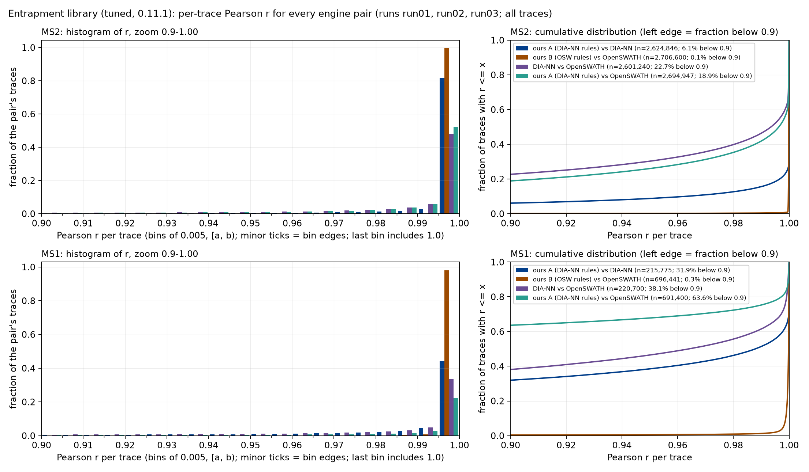
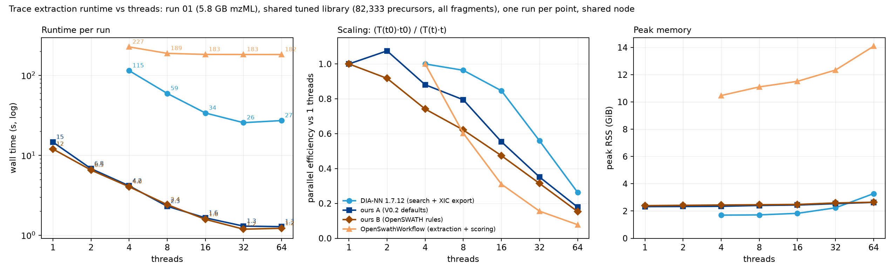

# ODIA-V3 trace extraction: dossier (2026-10-11, updated 2026-10-12)

**Goal.** Fast, memory-efficient extraction of DIA fragment and precursor traces (XICs) from a *predicted, recalibrated*
library, exported as Parquet/TSV for comparison with DIA-NN and OpenSWATH. Scoring, FDR and PyProphet are out of scope.

**Tool.** `DIATraceExtractor`, an OpenMS TOPP tool (C++23, OpenMS develop), in the repo okohlbacher/dia-trace-extract-prototype.
- **Run grid.** One global RT axis made of DIA cycles, with a compact peak store of 8 bytes per peak.
- **Library.** Read as a stream, in parts.
- **Work.** A central scheduler runs reading, extraction, encoding and writing on one worker pool.
- **Output.** Traces on the global axis plus their exact acquisition times; deterministic for any thread count.
- **Rule sets.** *A* follows DIA-NN (max of the centroids in the window, mass-corrected); *B* follows OpenSWATH (sum, isotopes at
  1.00336 Th).

**Data.** ProteoBench DIA entrapment, Orbitrap Astral, 15 min, 3 runs (5.8 GB mzML each). DIA-NN is the last open-source
version, 1.7.12, with its `--xic` export patched.

## 1. Libraries: tuned vs untuned (DIALibGen 0.11.1)

Libraries are predicted by DIALibGen 0.11.1. The *tuned* versions come from `-mode tune`: the RT model is fine-tuned on DIA-NN
1.7.12 IDs from run 01, and predicts in run minutes. DIA-NN takes each library as a spectral library (`--lib` TSV, which now has
a `UniprotID` column; without it DIA-NN reported "0 protein groups").

| library | DIA-NN IDs at 1% FDR, run 01 (untuned → tuned) | tuned, runs 02 / 03 | RT error, robust SD (untuned¹ → tuned, runs 01/02/03) | IDs within ±60 s |
|---|---|---|---|---|
| entrapment (7.0 M precursors) | 78,405 → 82,333 (+5%) | 79,545 / 80,058 | 24.2 s → 12.5 / 12.9 / 13.3 s | 94.5% → 97.3–97.9% |
| human (3.5 M precursors) | 84,076 → 93,300 (+11%) | 92,035 / 92,211 | 21.9 s → 7.4 / 7.2 / 7.7 s | 95.4% → 98.3–99.7% |

¹ Untuned: the raw prediction after DIA-NN's own RT calibration (its best case). Tuned: the RT stored in the library, with no
further calibration. Runs 02 and 03 were not used for tuning.

## 2. How similar are the traces? (shared tuned library, all IDs, runs 01–03)

All engines extract from the same library, restricted to DIA-NN's 1% FDR IDs, with the same ±60 s window and the same m/z
tolerance.

| pair (entrapment; human similar) | MS2 median r | MS2 r ≥ 0.995 | MS1 median r |
|---|---|---|---|
| ours B (OpenSWATH rules) vs OpenSWATH | 0.9999 | ≈ 99% | 0.9998 |
| ours A (DIA-NN rules) vs DIA-NN | 1.0000 | 81% | 0.988 |
| DIA-NN vs OpenSWATH | 0.994 | 48% | 0.964 |
| ours A vs OpenSWATH | 0.996 | 52% | 0.56² |

² At MS1, OpenSWATH places isotope k at mz + k·1.00336, without dividing by the charge. For charge ≥ 2 its "M+1/M+2" traces are
therefore a different ion. M+0 agrees (r 0.998).

- **We reproduce each engine's rules.** Ours B matches OpenSWATH nearly exactly. Ours A matches DIA-NN at MS2. The remaining
  differences to DIA-NN are explained in §3.
- **The two reference engines disagree with each other** more than either disagrees with its matching configuration of ours.
- **Galleries.** `figures/trace_mirror_random.png` holds 50 random precursors with mirrored pairs (ours A vs DIA-NN | ours B vs
  OpenSWATH | OpenSWATH vs DIA-NN). Precursors are grouped by how the engines diverge:

  | divergence mode | share |
  |---|---|
  | all agree | 17% |
  | minor differences | 25% |
  | MS1 only | 30% |
  | MS2 shape differs | 15% |
  | DIA-NN XIC truncated | 6% |
  | low signal | 6% |
  | scale only | 1% |

  No mode is caused by an RT shift: all engines read the same spectra. `figures/trace_gallery_by_mode.png` shows the same
  precursors overlaid rather than mirrored.

## 3. Which traces are more correct?

There is no ground truth, so we judged the extraction **rules**. We re-extracted 3,000 random IDs directly from the mzML, recording
every centroid near each target. Our emulation of each engine reproduces its exported traces (median r 1.0). Details are in
[analysis/trace_quality.md](analysis/trace_quality.md) and [analysis/ms1_divergence.md](analysis/ms1_divergence.md).

**True MS2 mass error.** Apex centroids of confident IDs give:
- **Offset.** Essentially constant: −3.3 ppm (run 01), −2.5 ppm (run 02).
  - DIA-NN's quadratic correction is *worse* than a constant at the m/z extremes.
  - Our self-calibrated offset is about 0.55 ppm too high.
- **Intensity drift.** Strong centroids drift upward by +1.45 ppm per decade above 6×10⁴.
- **Spread.** σ ≈ 2.4 / 1.1 / 0.86 ppm at intensities 10³ / 10⁴ / 10⁵.

**Interference and signal capture**, inside the peak region:

| | MS2 | MS1 |
|---|---|---|
| DIA-NN | 99.5% capture, ~2.9% interference | export uses the narrow window but at the **uncorrected** m/z: 92% capture, 5% interference |
| ours A | 99.5% capture, ~2.9% interference | wide window: 100% capture, 22% interference |
| OpenSWATH / ours B | 97.3% capture (no mass correction, so the window edge sits close to the true peak position) | wide window: 100% capture, 22% interference |
| **ours, narrow MS1 window (±2.1 ppm, our offset)** | — | **98% capture, 1.1% interference** |

Max vs sum is irrelevant on Astral data: two centroids share a window in at most 4×10⁻⁵ of points.

**Shape quality** on the actual exports, run 01, all IDs:

| | ours A / DIA-NN | OpenSWATH / ours B |
|---|---|---|
| fragment co-elution | 0.54 | 0.48 |
| library cosine at apex | 0.926 | 0.911 |
| dropouts inside the peak | 13.0% | 15.4% |
| isolated spikes | 8.8% | 11.5% |

- On run 02 (±8.3 ppm window) there is no MS2 difference between the engines.
- MS1-vs-fragment co-elution: our narrow MS1 window 0.887 > DIA-NN 0.880 > ours A 0.840 > OpenSWATH 0.826.

**Verdict.**
- **MS2:** DIA-NN-style extraction (ours A) gives the cleanest traces.
- **MS1:** ours with a narrow, mass-corrected window gives the best traces of all, better than DIA-NN's export.
- **OpenSWATH:** its uncorrected window and its isotope spacing cost quality.

**How narrow can MS2 go?** Keeping 99% / 99.5% of the true signal needs ±5 / ±6 ppm. Shape quality peaks at ±6 ppm (co-elution
0.523 at ±6 vs 0.506 at ±4 and 0.461 at ±3). DIA-NN's ±5.9 ppm on run 01 is already right; on run 02 its ±8.3 ppm is too wide.
Windows that widen with intensity do not help.

**Recommended rule for ours A:**
- **MS2:** constant offset from the median apex error, fixed ±6 ppm.
- **MS1:** our offset with ±2.1–2.5 ppm (about 3σ).
- **Ours B:** unchanged, for OpenSWATH parity.

### 3.1 The recommended rule, adopted (commit bbad38c)

**What changed in the tool:**
- **Mass offsets** are the *unweighted* median of the apex errors. Fragments with less than 10% of the anchor's apex signal are
  ignored.
  - Offsets now: −3.23 / −2.43 ppm on runs 01 / 02, against the analysis's true values of −3.29 / −2.47. The old weighted median
    was off by about 0.55 ppm.
- **Measured accuracy:** 5 × the 70th percentile of the residuals of strict anchors.
  - MS2 ≈ ±5 ppm, MS1 ≈ ±2.1 ppm (DIA-NN: 2.13). The values are stable on full predicted libraries too.
  - `-mz_tol 0` / `-mz_tol_ms1 0` use the measured values.
- **MS1 traces are raw values at the MS1 scans** (`-ms1_axis scans`, now the default), no longer interpolated onto the cycle
  axis. The Astral records 3 MS1 scans per cycle.
- **Configurations:**
  - **ours A:** MS2 ±6 ppm and the measured MS1 tolerance.
  - **ours P:** the previous DIA-NN-parity settings (both tolerances = DIA-NN's MS2 accuracy).
  - **ours B:** unchanged (OpenSWATH rules).

**Effect** (entrapment, all IDs; median Pearson r of the monoisotopic MS1 trace, M+0):

| | run 01 | run 02 | run 03 |
|---|---|---|---|
| ours A vs DIA-NN, MS1 M+0 | 0.978 (log2 ratio +0.02) | 0.996 (0.00) | 0.991 (0.00) |
| ours P (wide window) vs DIA-NN, MS1 M+0 | 0.954 (+0.23) | 0.952 (+0.25) | 0.982 (+0.12) |
| ours A vs DIA-NN, MS2 share of traces with r > 0.9 | 92.0% | 83.7% (±6 vs DIA-NN's ±8.3 ppm) | 90.6% |

**Human library, the same comparison:**

| | run 01 | run 02 | run 03 |
|---|---|---|---|
| ours A vs DIA-NN, MS1 M+0 | 0.962 (log2 ratio +0.05) | 0.995 (0.00) | 0.988 (0.00) |
| ours P (wide window) vs DIA-NN, MS1 M+0 | 0.891 (+0.42) | 0.957 (+0.22) | 0.971 (+0.16) |
| ours A vs DIA-NN, MS2 share of traces with r > 0.9 | 84.5% | 85.7% | 92.2% |
| ours P vs DIA-NN, MS2 share of traces with r > 0.9 | 93.6% | 93.7% | 92.2% |

- **The ours A vs ours P gap at MS2** comes from window width: ours A uses ±6 ppm, DIA-NN up to ±7.7 ppm on human runs 01 and 02.
- **Calibration matches the entrapment runs:** offsets −3.22 / −2.43 / −2.05 ppm, measured accuracy MS2 ±4.6–5.0 and MS1
  ±2.07–2.18 ppm.

MS1 agreement is now measured at every raw MS1 scan rather than every third. Before, sampling at cycle times had smoothed away
scan-to-scan differences, so the earlier MS1 figures were somewhat flattering.

**Shape quality** on the actual exports, all IDs:

| | ours A (new rule) | DIA-NN | OpenSWATH | ours A (old rule) |
|---|---|---|---|---|
| MS2 fragment co-elution, run 01 / 02 | **0.541 / 0.560** | 0.540 / 0.554 | 0.484 / 0.555 | 0.541 / — |
| MS1-vs-fragment co-elution, run 01 / 02 | **0.886 / 0.889** | 0.880 / 0.895 | 0.826 / 0.802 | 0.840 / — |

- Ours A now matches or beats DIA-NN on every shape metric.
- Re-run on 2026-10-11 with the current binary (6 library × run combinations, `results/refined/summary_cbad9dd.md`):
  every agreement figure above is reproduced exactly, since the trace output is byte-identical across all optimisations.
- On run 02 the ±6 ppm MS2 window beats DIA-NN's ±8.3 ppm.

### 3.2 The remaining MS2 differences to DIA-NN, explained

Details are in [analysis/ms2_tail.md](analysis/ms2_tail.md); example traces in `figures/ms2_tail_examples_run01.png`.

**Size of the tail** (ours P vs DIA-NN, share of MS2 traces):

| | r < 0.9 | l1 > 0.01 |
|---|---|---|
| run 01 | 3.5% | 17.7% |
| run 02 | 2.3% | 11.2% |

- **Cause: the window centre explains 100% of the tail.** DIA-NN centres its window with an m/z-dependent quadratic correction,
  computed in float32.
- **Test:** emulating that arithmetic exactly reproduces *every* DIA-NN trace in a 3,000-precursor sample, 0 of 35,000 traces
  differing on either run. The emulation computes the centre as `f32(mz + t0·mz² + t1 + t2·mz)`, the margin as `f32(centre ·
  accuracy)`, applies strict bounds and takes the maximum.
- **Mechanism:** the two windows have the same width but are shifted by about 0.5 ppm. Only centroids in that sliver at either
  edge differ. These are often the upward-drifted apex centroids of strong peaks.
- **Ruled out:**
  - window assignment (the windows don't overlap);
  - fragment m/z (rounding differences of at most 0.06 ppm);
  - DIA-NN's XIC span or timing;
  - skipped spectra.
- **Verdict:** this is a DIA-NN rule choice, not a bug and nothing on our side. Its quadratic actually describes the true mass
  error *worse* than a constant does. Exact parity would need DIA-NN's coefficients, which it prints only at `--verbose 3`; a
  parity mode could read them.

## 4. Performance

**Current binary** (6d26c49), run 01, 64 threads, full tuned libraries (all precursors, top 6 fragments), mzML on local
`/scratch`, 2 runs each:

| library | total | calibration | extraction | peak RSS | traces |
|---|---|---|---|---|---|
| human, 3.49 M precursors | 5.9 s (8.5 s with the library cold on Ceph) | 0.5 s | 3.2 s | 3.8 GiB | 31.3 M |
| entrapment, 7.0 M precursors | 8.6–9.0 s | 0.5 s | 5.7–6.0 s | 4.7 GiB | 63.0 M |

**How we got here** (entrapment, full library, 64 threads):

| step | total | peak RSS | what changed |
|---|---|---|---|
| whole library in memory | 25.7 s | 6.7 GiB | baseline |
| streamed library, central scheduler, buffer pools | 21.0 s | 4.5 GiB | library never resident; trace and Arrow buffers recycled |
| merge join, bucket index, 32 output parts (e47b2e8) | 14.4–15.2 s | 4.7 GiB | one walk per spectrum; writer no longer the cap |
| global peak pool (5b99dda) | 11.9–12.0 s | 4.4 GiB | parsers decode straight into one mmap'd pool; ingest 3.4 → 0.3 s |
| Arrow pool per-thread cache, reserved builders, panel during ingest, parallel close (cbad9dd) | 10.1–10.4 s | 4.65 GiB | extraction CPU −20%; final drain 1.1 → 0.2 s |
| calibration stage 1 as a per-window merge join (6d26c49) | 8.6–9.0 s | 4.7 GiB | calibration 1.8 → 0.5 s, identical anchors |

Every step was checked for byte-identical output (trace hash). Details: `docs/06-parallel-efficiency.md`,
`docs/07-contention-diagnosis.md`.

How the extraction works:
- **Run grid.** All peaks of the run in one memory-mapped pool (m/z as uint32 at 1e-5 Th, intensity float32), indexed by
  window and cycle; MS1 on its own scan axis.
- **Library.** Streamed in parts; it is never resident as a whole.
- **Scheduling.** One worker pool with four task classes (read, extract, encode, write), rebalanced at every task by
  pipeline pressure; in-order issue and an ordered commit.
- **Merge join.** A unit's precursors (one isolation window, sorted by RT) form a sliding range per spectrum; each spectrum's
  centroids are walked once against the sorted fragment windows. A bucket index (~64 `uint16` per spectrum) skips m/z gaps.
- **Output.** 32 Parquet parts written by their own tasks; buffers recycled per thread.
- **Determinism.** Output is byte-identical for 1 and 64 threads.

**Runtime vs threads** (run 01, shared tuned library of 82,333 precursors with all fragments, one run per point;
`scripts/bench_threads.sh`, `results/threads_6d26c49/`; ours re-measured with 6d26c49, DIA-NN and OpenSWATH from
`results/threads/`, unchanged binaries):

| threads | ours A | ours B | DIA-NN 1.7.12³ | OpenSwathWorkflow⁴ |
|---|---|---|---|---|
| 4 | 5.5 s / 2.4 GiB | 3.8 s / 2.4 GiB | 115 s / 1.7 GiB | 227 s / 10.5 GiB |
| 8 | 3.4 s | 2.4 s | 59 s | 189 s |
| 16 | 2.3 s | 1.7 s | 34 s | 183 s |
| 32 | 1.8 s | 1.4 s | 26 s | 183 s |
| 64 | 1.8 s / 2.7 GiB | 1.4 s / 2.7 GiB | 27 s / 3.3 GiB | 182 s / 14.1 GiB |

³ DIA-NN can export traces only while it searches, so its time includes the search. ⁴ OpenSWATH's time includes its scoring.
Ours A is now the recommended rule (MS2 ±6 ppm, MS1 measured); before it used DIA-NN's tolerances (22.9 s at 4 threads,
6.1 s at 64, on the older binary).

- **Speed.** Ours A is 14–21× faster than DIA-NN and 40–100× faster than OpenSWATH at every thread count.
- **Ours A vs ours B.** A pays 0.4–1.7 s for its self-calibration (panel load and calibration).
- **Scaling.** Ours flattens beyond 32 threads at this size (1.8 s, of which ingest 0.3 s, panel and calibration ~1 s);
  on the full 7 M library extraction still scales to 64 threads.
- **OpenSWATH stops scaling at 8 threads,** while its memory grows to 14 GiB.
- **mzPeak input** goes through the mzpeak-openms library (submodule `external/mzpeak`, partitioned parallel read
  into the peak pool). Run 01 as a point-layout file: traces byte-identical to the mzML path, ingest 0.85 s at 64
  threads (mzML path 0.32 s; the library's decode stops scaling at ~32 threads). mzpeak-convert 0.18.0 files with
  vendor-centroided MS1 read in 3.6 s; their MS2 traces match the mzML path, the MS1 traces differ for 24% of
  precursors (vendor vs ProteoWizard centroiding). Details: `docs/08-mzpeak-reader-handoff-2.md` §6.

## 6. Generality: a second instrument (timsTOF SCP, diaPASEF)

ProteoBench diaPASEF module (HYE mixed-species, 25 ng, 30-min gradient, 8 TIMS ramps × 3 windows of 25 Th per cycle),
two runs (condition A/B replicate 01), converted with mzpeak-convert 0.18.0 (6.7–6.9 GB mzPeak each), a DIALibGen
timsTOF library of the HYE FASTA (4.15 M precursors), no reference engine (DIA-NN 1.7.12 reads no `.d`).

- **Grid.** A diaPASEF frame carries three isolation windows separated by ion mobility; the loader splits each frame by
  the per-peak mobility into its windows: 4,348 cycles × 24 windows, 104,340 window-spectra, 2.77 G points (the
  ims-compact layout expands every TIMS scan), 21 GB grid.
- **Calibration** (RT map and masses from the run): 146 / 142 strict anchors, 236 / 235 anchors; offsets MS2 −2.7 / −3.2
  ppm, MS1 −3.7 / −4.0 ppm; error widths MS2 5.7 / 5.2 ppm, MS1 5.5 / 5.7 ppm (Astral: 1.0 / 0.4); peak FWHM 3
  cycles (2.9 s); RT residual p99 55 / 60 s. Tolerances at 6σ: MS2 ±34 / ±31 ppm, MS1 ±33 / ±34 ppm.
- **Trade-off on the anchors' traces** (±10 / 15 / 20 / 25 / 34 ppm): co-elution 0.863 / 0.872 / 0.869 / 0.869 / 0.860,
  dropouts 6.1 / 4.5 / 3.5 / 3.3 / 2.8%: a plateau from ±15 ppm, 6σ at its upper edge.
- **Cost.** 73 s per run at 32 threads (ingest 24 s on the per-spectrum mzPeak path, calibration 5 s, extraction
  40–44 s), 33 GB peak RSS, 36.7 M traces.
- **Not yet:** a trace-level comparison with another engine on this data; the mobility dimension is not used in the
  extraction beyond the window split.

## 5. Open items

- **mzPeak:** integrated (mzpeak-openms `partitioned-read-2026-10-11`). Open: the reader's decode scales to ~12 cores
  only (ingest 0.85 s vs the 0.5 s target); the chunked/numpress decode is 4x slower than the point layout; the MS1
  centroiding reference (vendor vs ProteoWizard) is undecided.
- **DIALibGen PR #4:** after the merge, regenerate the libraries and re-measure library loading.
- **50K shared library (Justin).**
- **Lower priority:** scheduling beyond 64 threads; a compact-v2 library layout.
- **Dropped:** per-peptide RT refinement (to be handled by library refinement in DIALibGen); a DIA-NN exact-parity mode.
