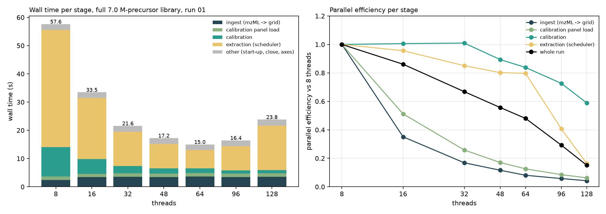
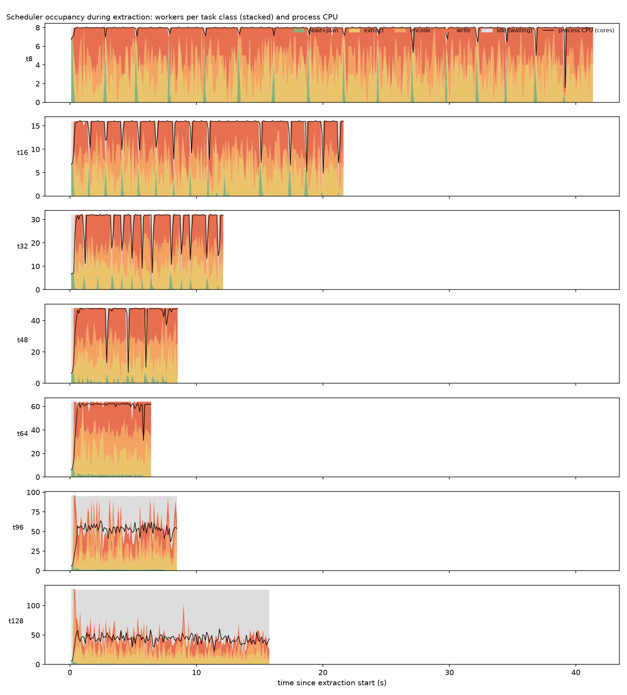

# Why parallel efficiency drops at high thread counts (2026-10-11)

**Setup.**
- **Workload:** full tuned entrapment library (7.0 M precursors, 63 M traces), run 01 (5.8 GB mzML). Settings are the recommended
  rule (MS2 ±6 ppm, measured MS1 tolerance, mass calibration); input and output are on local `/scratch`.
- **Instrumentation:** `ODIA_PROFILE=1` with a 100 ms scheduler timeline. Scripts: `scripts/profile_scaling.sh` and
  `scripts/analyze_profile_scaling.py`; raw data in `results/profile_scaling_scratch/`.
- **Machine:** 2 × 56 physical cores (AMD EPYC 9654, SMT, 2 NUMA nodes), shared with other users.
- **Runs:** one per point. A series with inputs on Ceph gave the same numbers within a few percent once the page cache was warm;
  input I/O is not a factor.

| threads | total | ingest | calibration panel load | calibration | extraction | other | efficiency vs 8 threads (total) | efficiency (extraction) |
|---|---|---|---|---|---|---|---|---|
| 8 | 57.6 s | 2.4 | 1.3 | 10.5 | 41.4 | 2.1 | 1.00 | 1.00 |
| 16 | 33.5 | 3.4 | 1.2 | 5.2 | 21.7 | 2.0 | 0.86 | 0.96 |
| 32 | 21.6 | 3.5 | 1.2 | 2.6 | 12.2 | 2.1 | 0.67 | 0.85 |
| 64 | 15.0 | 3.7 | 1.2 | 1.6 | 6.5 | 2.0 | 0.48 | 0.80 |
| 96 | 16.4 | 3.4 | 1.2 | 1.2 | 8.5 | 2.1 | 0.29 | 0.41 |
| 128 | 23.8 | 3.5 | 1.2 | 1.1 | 15.8 | 2.1 | 0.15 | 0.16 |
| 56, pinned to socket 0 | **14.0** | 3.4 | — | 1.6 | 6.0 | — | | |

## Reasons, ranked by their cost at 64 threads

### 1. Stages that do not scale: 6.9 s of 15.0 s (46%)

**Ingest, 3.4–3.7 s from 16 threads on.** It is *faster* at 8 threads (2.4 s).
- **Serial routing.** Spectra are parsed in parallel chunks, but routed into the grid one at a time, in file order (the ordered
  commit copies each spectrum's peaks into its window lane). That costs 1.5 s at 8 threads and 2.5 s at 16 or more, and it is the
  critical path.
- **Workers wait for the router.** They spend 45 thread-seconds waiting on its look-ahead window.
- **Parsing slows down with concurrency.** The same chunks take 3.8 thread-s to parse at 8 threads and 8.6 at 16 or more (×2.3),
  as more threads compete for memory bandwidth. That in turn slows the serial router.

**Calibration panel load, 1.2 s at every thread count.** It reads one part at a time from each of the library's 7 row groups,
so it runs at most 7-way parallel, and it is bounded by the longest row group.

**"Other", 2.0 s at every thread count.** This is process start-up (the OpenMP re-exec, OpenMS/TOPP initialisation), pre-faulting
the 512 MiB trace pool, writing the axes, closing the Parquet parts and the stats. It is not yet broken down further.

### 2. Each task gets slower as threads are added (hardware contention): about 20% of the extraction's work at 64 threads

The same tasks take longer at higher thread counts (milliseconds per task):

| class | 8 threads | 64 | 96 | 128 |
|---|---|---|---|---|
| extract | 2.55 | 2.66 (+4%) | 3.43 (+35%) | 5.92 (+132%) |
| encode | 2.01 | 2.91 (+45%) | 3.92 | 5.37 |
| write | 3.14 | 3.72 (+19%) | 4.47 | 6.92 |

- **Total worker time** rises from 327 to 392 thread-seconds at 64 threads.
- **Causes:**
  - **Memory bandwidth.** Encode and write stream gigabytes through Arrow and zstd.
  - **NUMA.** Beyond 56 threads the work spans both sockets, and the grid is read across the socket link.
  - **SMT.** At 128 threads, more threads than the 112 physical cores.
- **Evidence for NUMA:** 56 threads pinned to one socket (CPUs and memory) give the best time of all runs, 14.0 s. The same 56
  threads with memory interleaved across both nodes take 16.3 s, and 64 unpinned threads take 15.0 s.

### 3. Above 64 threads: the scheduler's ordered window and its lock

**The ordered window caps parallelism.** At most `min(4 × threads, 64)` units may be extracted ahead of the ordered commit.
- **Up to 64 threads** there is one slot per worker.
- **At 96 and 128 threads** the surplus workers wait: 280 and 1,209 thread-seconds of "ordered window full". Process CPU stays at
  about 50–55 cores whatever the thread count (see the timelines).

**The central lock and `notify_all` make it worse.**
- **Lock acquisition:** 0.7 s at 32 threads, 11.6 s at 64, 60 s at 96 and 108 s at 128 (thread-seconds).
- **Voluntary context switches:** 16 k at 8 threads, 0.4 M at 64 and 2.0 M at 128. Every finished task wakes every waiting
  worker, and they then queue on the one mutex.

### 4. Up to 48 threads: stalls at library-part boundaries (about 7% of extraction time at 32 threads)

The timelines show the whole pool stalling for 0.1–0.2 s every 1–2 s: the ordered commit reaches a library part that is not yet
read and planned.

| idle reason | 32 threads | 64 threads |
|---|---|---|
| next part not loaded | 27.9 thread-s | 2.6 |
| awaiting a library read | 8.7 | 12.9 |

Library parts are read only when few units are left (the low-water rule). Each part takes about 120 ms on one thread, and only 7
can be read at once (one per row group).

### Not a cause

- **Writing:** with 32 output parts, the sinks wait on each other for less than 1 thread-second, even at 128 threads.
- **The trace buffer pool:** never empty.
- **The end-of-run drain:** under 1 thread-second.
- **Input I/O:** with a warm cache, the marker scan takes 0.1 s and chunk reads 2 thread-seconds.

## What to do, in order of expected gain at 64 threads (now 15.0 s)

1. **Parallel routing in ingest.** The ordered commit should only assign each spectrum its (window, cycle, offset), which is
   cheap. The peak copy into the lanes can then run in parallel, or each chunk can be routed into chunk-local lanes that are
   merged per lane in parallel. Expected ingest time: 3.7 s → about 1 s.
2. **Overlap the stages.** The calibration panel load (1.2 s) and the first library parts do not need the grid, so they can be
   read while ingest runs. Expected gain: about 1–1.5 s.
3. **Break down the 2 s of "other"** and remove what is avoidable: the re-exec, pool pre-faulting in parallel, axes written
   during extraction.
4. **NUMA.**
   - Pin to one socket up to 56 threads: a free 7–15% today.
   - For batches of runs, run one process per socket (2 × 56 threads) instead of one process with 112 threads.
   - Longer term: first-touch the grid per node.
5. **Scheduler beyond 64 threads.**
   - Raise the ordered window. Its memory is already bounded by the pool.
   - Wake one worker per new task instead of all, and give each task class its own queue, shortening the time under the lock.
   - This removes the slowdown past 64 threads. It does not remove hardware reason 2.
6. **Read library parts earlier.** Read one or two parts ahead of the commit at all times, not only when few units are left.
   This removes the part-boundary stalls at 16–48 threads.

Applying 1–3 would bring a run at 56–64 threads from about 15 s to about 10–11 s. The extraction stage itself is already about 94%
occupied at 64 threads; what remains there is mostly the hardware contention of reason 2.
