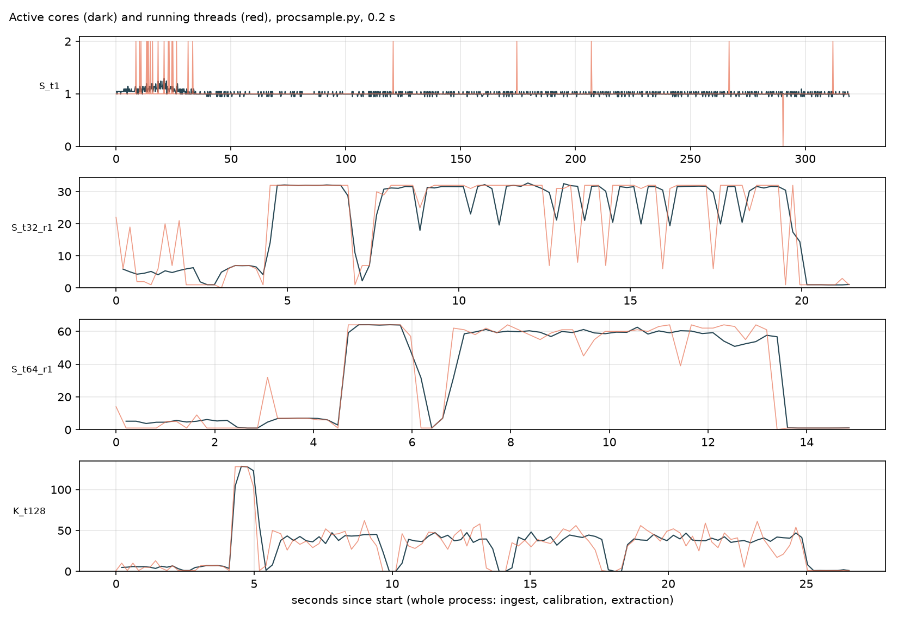

# Where the thread contention comes from (2026-10-11)

This diagnosis follows the `parallel-efficiency` skill: measure, attribute with testable hypotheses, then prove.

## Summary

At 64 threads the full 7.0 M-precursor run takes **15.15 s** (3 repeats, coefficient of variation 2.9%). With perfect scaling of
the 1-thread run (320 s) it would take **5.0 s**.

The 10.1 s gap breaks down as follows:

| loss at 64 threads | seconds | share of the gap | cause |
|---|---|---|---|
| CPU cost per task grows with threads (extraction) | 3.0 | 30% | contention *inside the process*. Confirmed part: shared atomic counters in our Arrow memory pool. The rest is still open. |
| Ingest scales only 10× | 2.9 | 29% | serial routing of spectra into the grid; overhead grows with threads (Karp–Flatt serial fraction 0.066 → 0.082) |
| Fixed serial "other" | 2.0 | 20% | start-up (re-exec, OpenMS/TOPP initialisation), pool pre-faulting, closing files, axes; identical at 1 and 64 threads |
| Calibration panel load | 1.2 | 12% | at most 7-way parallel (one source per row group) |
| Idle workers in extraction | 0.6 | 6% | part-boundary stalls, library reads |
| Calibration | 0.4 | 4% | scales well (efficiency 0.73) |

- **What it is not:** at up to 64 busy cores the hardware is **not** saturated. Memory bandwidth, shared L3 and machine-wide
  clock limits are refuted.
- **What it is:** the process slows itself down. Threads share mutable state, some phases are serial, and above 64 threads the
  scheduler caps itself.

## Setup

- **Machine:** `data`, an AMD EPYC 9654 with 2 × 56 cores visible (2 × 96 physical, 224 hardware threads online) and 2 NUMA
  nodes; shared with other users.
- **Kernel and power settings:** governor `schedutil`, automatic NUMA balancing on, no cgroup CPU quota, no throttling. `perf`
  is unavailable (`perf_event_paranoid` = 4), and so are hardware counters.
- **Input:** run 01 (5.8 GB mzML) and the full tuned entrapment library (7.0 M precursors, 63 M traces). Inputs and output on
  local `/scratch`, warm cache.
- **Binary:** `build-stream`, the current main branch plus opt-in instrumentation.
- **Hygiene** (`scripts/bench_run.py`):
  - an exclusive `flock` around each run;
  - CPU used by **other processes** recorded per run: 0.4–2.6 cores, small next to our 32–64;
  - external `/proc` sampling every 0.2 s (`procsample.py`);
  - optional gdb stack samples;
  - an output hash per run: **identical at 1, 32, 64 and 128 threads** (`f0ba8de676ec580c`).
- **Noise:** 3 interleaved repeats. 32 threads: 21.1 ± 0.9 s (CV 4.2%). 64 threads: 15.2 ± 0.4 s (CV 2.9%).

## Scaling (against the 1-thread run)

| stage | 1 thread | 32 threads | 64 threads | speed-up at 64 | efficiency at 64 | Karp–Flatt e (32 → 64) |
|---|---|---|---|---|---|---|
| whole run | 319.8 s | 21.1 | 15.2 | 21.1 | 0.33 | 0.036 → 0.032 (constant: a fixed serial part) |
| ingest | 36.0 | 3.4 | 3.5 | 10.4 | 0.16 | 0.066 → **0.082** (growing: overhead) |
| calibration | 70.9 | 2.5 | 1.5 | 46.7 | 0.73 | 0.004 → 0.006 |
| extraction | 205.9 | 12.0 | 6.9 | 30.0 | 0.47 | 0.028 → 0.018 |

- **Active cores** over the whole run: 34.5 on average at 64 threads; 21.7–22.0 at 32 threads.
- **Time at ≤ 1.5 active cores:** about 2 s per run, which is start-up.



## CPU cost per task: the same work costs more CPU as threads are added

Median CPU per task over all 40,848 tasks, from `getrusage(RUSAGE_THREAD)` before and after each task:

| class (ms CPU per task) | 1 thread | 16 | 32 | 64 | 128 | 4 processes × 16 threads |
|---|---|---|---|---|---|---|
| extract | 1.87 | 2.42 | 2.59 | 2.21–2.41 | 4.75 | 2.17–2.37 |
| encode | 1.06 | 2.01 | 2.28 | 2.53–2.92 | 3.85 | 1.83–1.94 |
| write | 1.82 | 3.20 | 3.46 | 3.31–3.42 | 5.87 | 2.57–2.75 |

- Tasks run on the CPU almost all the time (CPU/wall 0.90–1.00), so this is **slower execution, not blocking**.
- Total CPU for the run rises from 322 s at 1 thread to about 505 s at 64 threads (+57%). At 64 threads that inflation alone
  caps efficiency at about 0.64.

## Hypotheses and verdicts

| # | hypothesis | prediction | result | verdict |
|---|---|---|---|---|
| H1 | Shared hardware saturates (memory bandwidth, L3, power) | concurrent independent processes slow each other down | 2 × 32 processes: 11.8–11.9 s extraction each, against 12.7 s for one alone. 4 × 16: 19.2–20.4 s against 21.6 s. CPU per task for 4 × 16 equals 1 × 16 | **refuted** at ≤ 64 busy cores |
| H2 | Shared atomic counters in `RecyclingPool` (true sharing: bytes, peak via a compare-and-swap loop, total, count on every Arrow allocation) | removing them lowers encode CPU at 64 threads | A/B test (`ODIA_POOL_NO_ACCOUNT=1`), 2 × 2 interleaved runs: encode 2.91 → 2.24 ms/task (−23%), blocking switches 7.0 → 2.4 per task, extraction CPU −10%, **extraction wall 7.05 → 6.19 s (−12%)**, output identical | **confirmed** |
| H3 | Arrow builders grow step by step: reallocations plus copies | `Reallocate` appears in running stack samples | 29 of about 190 running samples at 64 threads (15%) are in `RecyclingPool::Reallocate`. This is work at every thread count, and it adds to the contention in H2 | **confirmed** (as work) |
| H4 | The pool's free-list mutexes are contended | lock waits are significant | 2–4 thread-s at 64 threads (< 1% of busy time); 3 of 408 stack samples | minor |
| H5 | Above 64 threads, the scheduler's ordered window and central lock | idle workers parked in the condition wait and on the scheduler mutex | 128 threads: per sample 89–104 workers in `worker_` waiting on the condition variable and 13–20 in `relock_` waiting on the mutex, only 18–26 running. "Ordered window full" 1,209 thread-s; 2.0 M voluntary context switches | **confirmed** |
| H6 | Spinning (OpenMP / runtime wait policies) | CPU grows while wall stays flat; threads spin | CPU/wall per task 0.9–1.0. The 127 idle OpenMP threads (a hidden pool left over from ingest and calibration) sleep in futex waits (passive policy) | **refuted** |
| H7 | Serial phases (Amdahl) | constant Karp–Flatt e; flat stage times | whole-run e ≈ 0.03 (constant). Flat stages: ingest 3.4 s, panel 1.2 s, "other" 2.0 s (the same at 1 and 64 threads) | **confirmed** |
| H8 | NUMA (both sockets, first touch, automatic balancing) | pinning one process per socket helps | node-bound 2 × 32: 10.1–10.3 s extraction against 11.8–11.9 s unpinned (−13%); 56 threads on one socket: 14.0 s total, the best of all runs | **confirmed** (moderate) |
| H9 | SMT siblings | 112 threads on one socket's 56 cores are slower than 56 | 15.5 s against 14.0 s | **confirmed**: use physical cores |
| H10 | Clock frequency (`schedutil` with threads roaming) | per-task CPU follows the frequency | the sysfs readings (`acpi-cpufreq` `scaling_cur_freq`) contradict themselves: the 1-thread run reads 1.5 GHz yet has the cheapest tasks, so they are not the effective clock | **undetermined** |
| H11 | Per-task scheduling overhead | small units cost more | 64 precursors per unit: 25.7 s; 256 (default): 15.3 s; 1024: 14.95 s (within noise) | confirmed for small units only; the default is fine |

**Still unexplained:** after removing H2, encode still costs 2.2 against 1.06 ms per task (×2.1) and write 3.3 against 1.8 ms
(×1.8). Extract costs ×1.2.

The remaining candidates, each with its next test:

| candidate | next test |
|---|---|
| per-size-class free lists and glibc small allocations shared across threads | per-thread pool caches |
| L2/L3 sharing within a CCD (8 cores per 32 MB L3) | one thread per CCD, pinned |
| clock frequency | a fixed-work CPU probe per run, independent of sysfs |

## Fixes, ranked by measured or expected effect at 64 threads

All of these keep the output identical; equivalence was checked by hash for every run here.

1. **Make the pool's statistics per thread.** Measured: −12% extraction wall (H2).
   - Use thread-local or striped counters, summed when reported.
   - Better still, give each thread its own cache of recycled buffers in front of the shared free lists, which also removes H4.
2. **Reserve Arrow builders up front** (H3). Rows and bytes per unit are known before encoding, so `Reserve` /
   `ReserveData` once per builder removes the reallocations and copies (15% of samples).
3. **Parallel routing in ingest** (§7.2 of `06`). Expected: 3.5 s → about 1 s.
4. **Overlap the calibration panel load and the first library parts with ingest.** Expected: about 1 s.
5. **Break down and trim the 2 s of "other"** (start-up, pool pre-faulting, closing).
6. **Placement.**
   - Pin to one socket up to 56 threads (−7 to −13% today).
   - For batches of runs, run one process per socket.
   - For throughput, several processes beat one big one: 4 × 16 delivered 77% more runs per hour than 1 × 64.
7. **Scheduler beyond 64 threads** (H5).
   - Raise the ordered window; it is bounded by the trace pool anyway.
   - Wake one worker per task instead of `notify_all`.
   - Give each task class its own queue.

## Reproduction

```bash
scripts/diagnose_contention.sh results/contention A B C D        # thread series, multi-process, unit size, SMT/NUMA
scripts/diagnose_contention2.sh results/contention2 S K          # 1-thread baseline, noise repeats, stack samples
python3 scripts/analyze_contention.py results/contention results/contention/analysis
python3 scripts/analyze_contention2.py results/contention2 results/contention2/analysis
# H2 A/B test: ODIA_POOL_NO_ACCOUNT=1 (diagnosis only), results/contention3
```

**Instrumentation**, all opt-in:
- `ODIA_PROFILE=1`: per-task CPU, faults and context switches; lock waits; scheduler idle reasons.
- `ODIA_PROFILE_TIMELINE=file`: a 100 ms timeline.
- `ODIA_ALLOW_PTRACE=1`: lets gdb stack samples attach.
- `ODIA_POOL_NO_ACCOUNT=1`: the H2 test.
