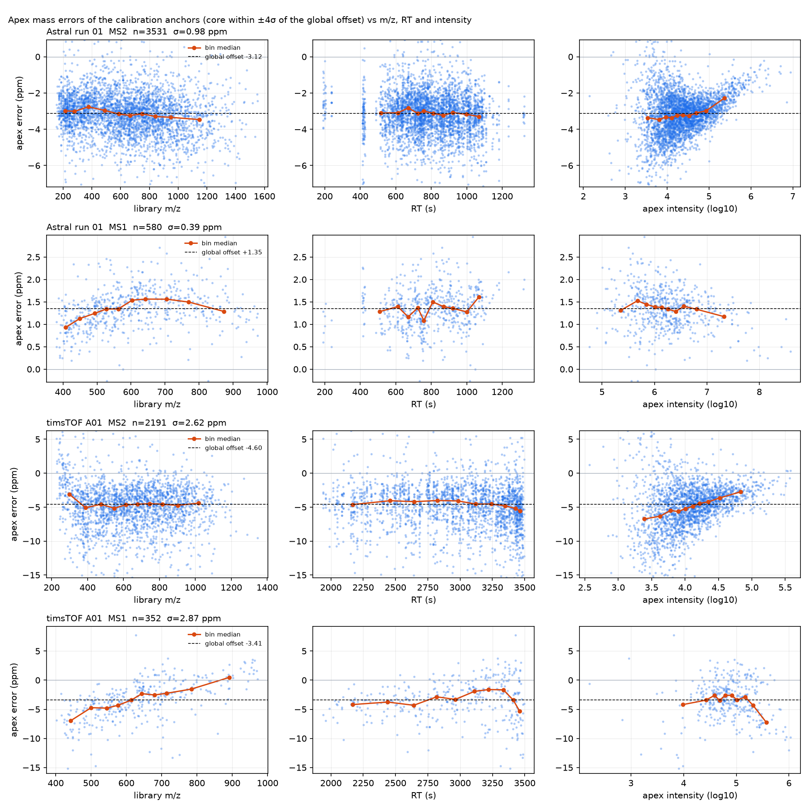

# DIATraceExtractor V0.2: release report (2026-10-12)

**What it is.** `DIATraceExtractor` is an OpenMS TOPP tool (C++23, OpenMS develop) that extracts DIA fragment and
precursor-isotope traces (XICs) from a predicted spectral library and writes them as Parquet/TSV. It calibrates
retention time and mass against the run itself, needs no identifications, and does no scoring. This report
gathers what has been measured about the quality of its traces and its speed against DIA-NN 1.7.12 and
OpenSWATH, the design decisions those measurements led to, and what is still open. Details live in the dossier
(`00-dossier.md`), the extraction description (`EXTRACTION.md`) and the backlog (`BACKLOG.md`).

**Verdict in one paragraph.** At equal extraction rules the three tools produce the same traces; the differences
between them are rule choices, and ours are the best-supported ones: a mass offset measured from the run (both
instruments need it), a tolerance expressed in multiples of the measured error width, and a narrow,
mass-corrected MS1 window that captures 98% of the signal at 1% interference where DIA-NN's export captures 92%
at 5% and OpenSWATH 100% at 22%. The extraction runs 14–21× faster than DIA-NN and 40–100× faster than OpenSWATH
on the same inputs, in 2.7 GiB, with byte-identical output at any thread count and from any of the three readers
(fast mzML, OpenMS mzML, mzPeak). It runs end to end on a second instrument class (timsTOF diaPASEF) with the
same agreement to DIA-NN as on the Orbitrap Astral. What remains open is one modelling question: the tolerance
multiple is set per instrument class from the identification screen, not measured from the run, because the
calibration anchors cannot see the interference that sets the optimum.

## 1. Data, libraries, references

| | Orbitrap Astral | timsTOF SCP (diaPASEF) |
|---|---|---|
| data set | ProteoBench DIA entrapment, 15 min, 50 ng, runs 01–03 (5.8 GB mzML each) | ProteoBench diaPASEF, conditions A and B, sample Alpha 01 (`.d`, converted to mzPeak and, by this tool, to mzML) |
| library | DIALibGen 0.11.1, human (3.5 M precursors) and entrapment (7.0 M); RT model tuned on DIA-NN IDs of run 01 | DIALibGen, HYE mixed species, 4.15 M precursors (predicted RT, `-rt_mode auto`) |
| reference traces | DIA-NN 1.7.12 (last open-source version, `--xic` export patched), OpenSwathWorkflow (OpenMS develop) | DIA-NN 1.7.12 on our mzML export (1.7.12 reads no `.d`) |
| restriction for comparisons | DIA-NN's 1% FDR IDs (78–93 k precursors) | DIA-NN's IDs (54,557 A01; 55,665 B01) |

DIA-NN exports traces only while searching, so its times include the search; OpenSWATH's include its scoring.

## 2. How the extraction works


- **Run grid.** Every centroid of the run goes into one memory-mapped pool (m/z as uint32 at 1e-5 Th, intensity as
  float32: 8 bytes per peak), indexed by isolation window and DIA cycle, with MS1 on its own scan axis. Three
  readers feed it: a fast mzML parser, the OpenMS mzML reader, and the mzpeak-openms library for mzPeak files
  (diaPASEF frames are split per isolation window and collapsed across TIMS scans within 15 ppm).
- **Calibration** (`EXTRACTION.md` §3). A panel of 5% of the library (every k-th row, never the `-ids` subset) is
  searched for co-eluting fragment apexes: a strict first pass over the whole run yields anchors for a robust
  LOWESS RT map; a relaxed second pass within ±max(4σ, 30 s) of the map refines it. The apex centroids of the
  strict anchors give the mass model: a median offset, or a line offset + slope × m/z when the m/z dependence is
  material (new in V0.2), and the error width as 1.4826 × MAD of the residuals. Tolerances are multiples of that
  width.
- **Extraction.** Each precursor's fragments and MS1 isotopes are extracted within ±60 s of the mapped RT (or a
  measured window, `-rt_window 0`), by a merge join of the sorted target windows against each spectrum's
  centroids, taking the most intense centroid per window (DIA-NN's rule, `-aggregation max`) or their sum
  (OpenSWATH's, `sum`).
- **Output.** Traces as Parquet (`-out`, one row per trace, sharded) or as a long TSV (`-out_tsv`), with the axes
  file (`-out_axes`: global cycle axis, exact acquisition times per window, MS1 scan times), run statistics as
  JSON (`-out_stats`), the calibration anchors as TSV (`-out_calibration`, reusable as `-rt_anchors`), and the
  loaded run as a centroided mzML (`-out_mzml`, one spectrum per isolation window; how the diaPASEF runs reached
  DIA-NN).
- **Scheduling.** One worker pool runs library reading, extraction, encoding and writing as task classes
  rebalanced by pipeline pressure, with in-order issue and an ordered commit, so the output does not depend on
  the thread count.


## 3. Are the traces the same? (Astral, shared tuned library, all DIA-NN IDs)


| pair | MS2 median r | MS2 r ≥ 0.995 | MS1 median r |
|---|---|---|---|
| ours B (OpenSWATH rules) vs OpenSWATH | 0.9999 | ≈ 99% | 0.9998 |
| ours A (DIA-NN rules) vs DIA-NN | 1.0000 | 81% | 0.988 |
| DIA-NN vs OpenSWATH | 0.994 | 48% | 0.964 |

Ours B reproduces OpenSWATH nearly exactly; ours A reproduces DIA-NN at MS2. The two reference engines disagree
with each other more than either disagrees with its matching configuration of ours. The remaining MS2 tail against
DIA-NN (3.5% of traces with r < 0.9 on run 01) is entirely its float32 quadratic window centre, shifted by about
0.5 ppm from ours: emulating that arithmetic reproduces every one of 35,000 DIA-NN traces in a sample (dossier
§3.2). It is a DIA-NN rule choice, and its quadratic describes the true mass error worse than a constant does.

## 4. Which rules are right? (re-extraction from the raw centroids, 3,000 IDs)

| | MS2 | MS1 |
|---|---|---|
| DIA-NN | 99.5% capture, 2.9% interference | export at the **uncorrected** m/z: 92% capture, 5% interference |
| ours (V0.1 rule) | 99.5% capture, 2.9% interference | narrow corrected window: **98% capture, 1.1% interference** |
| OpenSWATH | 97.3% capture (no mass correction) | wide window: 100% capture, 22% interference |

Shape metrics on the actual exports agree (run 01 / 02): fragment co-elution ours 0.541 / 0.560, DIA-NN 0.540 /
0.554, OpenSWATH 0.484 / 0.555; MS1-to-fragment co-elution ours 0.886 / 0.889, DIA-NN 0.880 / 0.895, OpenSWATH
0.826 / 0.802. OpenSWATH additionally places isotope k at m/z + k·1.00336 without dividing by the charge, so its
M+1 and M+2 traces of charge ≥ 2 precursors are a different ion.


## 5. The structure of the mass errors, and the mass model



Apex errors of the calibration anchors against library m/z, RT and intensity (core within ±4σ of the offset):

| | global offset | σ (MAD) | σ after an m/z + RT model | what the data show |
|---|---|---|---|---|
| Astral MS2 | −3.12 ppm | 0.98 | 0.94 | centred after the offset; trends < 0.5 ppm |
| Astral MS1 | +1.35 ppm | 0.39 | 0.32 | mild m/z curvature |
| timsTOF MS2 | −4.60 ppm | 2.62 | 2.55 | small RT drift (−1.2 ppm over the run) |
| timsTOF MS1 | −3.41 ppm | 2.87 | 2.02 | **linear in m/z: +15 ppm per 1000 Th** |

- Both instruments have a systematic shift of 1–5 ppm; the offset is essential and the tool measures it.
- After the offset the residuals are centred (mean = median, no skew). An m/z-dependent term matters only for
  timsTOF MS1, where a line narrows σ by 29%. The mass model is therefore offset + slope × (m/z − reference),
  kept only when the shift over the central 90% of the m/z range exceeds half the width and three standard
  errors (`calibration:mass_model linear`, the default). On Astral it changes nothing measurable (agreement
  with DIA-NN: MS2 87.3%, MS1 72.3% vs 72.1% with the constant model on the shared run-01 library).
- The dominant remaining structure is **intensity**: weak centroids sit low, strong ones high (Astral MS2 −0.4 →
  +0.7 ppm, timsTOF MS2 −2.2 → +1.6 ppm from the weakest to the strongest decile). It cannot be corrected before
  extraction, and it is the reason the width measured on strong anchors understates what weak fragments need.

## 6. Trace quality as a function of the tolerance (both instruments)


The DIA-NN-identified precursors extracted at k × σ, k = 1 … 12, and scored on the traces (`scripts/tolerance_screen.py`):

| | MS2 co-elution optimum | MS1 optimum | DIA-NN's own accuracy |
|---|---|---|---|
| Astral run 01 | k = 8–10 (±7.4–9.2 ppm) | k = 4 (±1.6 ppm) | 6.4σ (±5.9 ppm) |
| timsTOF A01 | k = 4–5 (±10.6–13.3 ppm) | k = 4 (±13.5 ppm) | 4.4σ (±11.8 ppm) |

On Astral the curve saturates (heavy error tail, dropouts keep falling); on timsTOF it peaks and falls (Gaussian
errors, interference costs beyond 5σ). DIA-NN's optimised accuracy sits at each instrument's optimum; MS1 peaks at
4σ on both.

**Can the calibration find the multiple by itself?** No. Every anchor-based criterion tried rises monotonically to
8σ on timsTOF too: the all-fragment co-elution curve of the anchors, the same on the weaker half of the anchors, on
their weak fragments only, and on both; and the anchor yield at a 1% decoy-calibrated false rate, which the
shifted-fragment decoys make meaningless (0–5 decoys per run). Anchors are present precursors whose fragments stay
correlated as the window widens; the screen's optimum comes from interference in weak and absent precursors, a
population the calibration does not have. **Decision:** the multiples are set per instrument class from the run's
metadata (MS2 9σ Orbitrap/Astral, 4σ timsTOF and other TOF, 6σ with a warning when unknown; MS1 4σ), as explicit
options (`-mz_sigma_ms2`, `-mz_sigma_ms1`; `-mz_tol*` for fixed ppm). A measured criterion needs a population
containing absent peptides, i.e. peptide decoys from the library generator (backlog).

## 7. A second instrument: timsTOF SCP diaPASEF

Runs A01 and B01 go through the mzPeak reader (frames split per isolation window, TIMS scans collapsed within
15 ppm) and through DIA-NN 1.7.12 via our mzML export. Calibration finds 775 anchors (25 ng sample), MS2 width
2.6–2.7 ppm, MS1 2.2 ppm with the m/z model.

| ours vs DIA-NN (its IDs) | MS2 median r | MS2 r > 0.9 | MS1 r > 0.9 |
|---|---|---|---|
| A01, defaults (4σ) | 0.992 | 86.0% | 63% |
| A01, at DIA-NN's ±11.8 ppm | 0.9993 | 91.7% | 60% |
| B01, defaults (4σ) | 0.974 | 76.0% | 67% |
| B01, at ±11.8 ppm (DIA-NN: ±12.6) | 0.996 | 89.4% | 66% |

At equal tolerance the engines agree on diaPASEF as on Astral. **MS1 agreement of 60–67% looked like a defect and
is not:** where both engines have signal the values are identical, and each has zeros where the other has signal,
so the two windows sit at different centres. Placing our MS1 window at the uncorrected library m/z with DIA-NN's
MS2 accuracy raises the agreement to 79% (widening to ±20 ppm drops it to 43%): DIA-NN's XIC export takes MS1 at
the uncorrected m/z with its MS2 accuracy, the rule already found on Astral (§4), where the 1.3 ppm MS1 offset
hides it; here the offset is 3.4 ppm plus the m/z slope. Our MS1 traces are the mass-corrected ones.

## 8. Performance

Machine: 2 × AMD EPYC 9654 (56 cores per socket online, SMT), shared node; inputs on local `/scratch`; one run per
point unless stated; peak RSS from `/usr/bin/time`.

**Runtime vs threads**, run 01, shared tuned library (82,333 precursors, all fragments); ours at the V0.2 defaults
(commit cb466f0), DIA-NN and OpenSWATH from the same series with unchanged binaries:


| threads | ours A (defaults) | ours B (OpenSWATH rules) | DIA-NN 1.7.12 | OpenSwathWorkflow |
|---|---|---|---|---|
| 4 | 4.4 s / 2.4 GiB | 4.4 s / 2.4 GiB | 115 s / 1.7 GiB | 227 s / 10.5 GiB |
| 8 | 2.6 s | 2.6 s | 59 s | 189 s |
| 16 | 1.9 s | 1.9 s | 34 s | 183 s |
| 32 | 1.6 s | 1.6 s | 26 s | 183 s |
| 64 | 1.6 s / 2.7 GiB | 1.6 s / 2.7 GiB | 27 s / 3.3 GiB | 182 s / 14.1 GiB |

Ours is 21–26× faster than DIA-NN and 52–114× faster than OpenSWATH at every thread count (both references do
more: DIA-NN searches, OpenSWATH scores). Ours flattens beyond 32 threads at this library size (1.6 s, of which
ingest 0.3 s and calibration about 0.5 s); OpenSWATH stops scaling at 8 threads while its memory grows to 14 GiB.
The node carried a load of 13–16 from other users during the series (`results/threads_cb466f0`).

**Full libraries**, run 01, 64 threads, top 6 fragments, V0.2 defaults:

| library | total (2 runs) | calibration | extraction | peak RSS | traces |
|---|---|---|---|---|---|
| human, 3.49 M precursors | 5.8–6.1 s | 0.5 s | 3.3–3.4 s | 3.9 GiB | 31.3 M |
| entrapment, 7.0 M precursors | 9.3 s | 1.0 s | 6.1–6.2 s | 4.8 GiB | 63.0 M |

Measured at a node load of about 21; the same binary measured 8.6–9.0 s on the entrapment library on a quieter
node (dossier §4). Output is byte-identical for 1 and 64 threads and across the three readers.

**diaPASEF** (A01, 4.15 M-precursor library, 24 threads): 45 s wall, 13.8 GB peak RSS, 36.7 M traces; the mzPeak
per-spectrum read and the mobility collapse take 20–26 s of it, the calibration 4 s, the extraction 12–13 s.

**What the speed rests on** (dossier §4, `06-parallel-efficiency.md`, `07-contention-diagnosis.md`): one mmap'd
peak pool the parsers decode straight into; the library streamed in parts, never resident; one merge join per
spectrum with a bucket index over m/z; a central scheduler with four task classes and an ordered commit;
recycled trace and Arrow buffers with a per-thread cache; 32 Parquet parts written by their own tasks. Each step
was accepted only with a byte-identical trace hash. The library-load transient (decoded row groups, parts and the
joined copy coexisting) and the mzPeak reader's serialised decode (scales to 10–14 cores) are the known remaining
costs.

## 9. Changes since V0.1

- Tolerances as multiples of the measured error widths, per instrument class (`-mz_sigma_ms2`, `-mz_sigma_ms1`);
  the instrument read from the run's metadata.
- Mass model with an m/z-dependent term when the data support it (`calibration:mass_model`).
- `-rt_window 0` = measured window; co-elution window from the measured peak width; calibration constants
  configurable; panel as a share of the library (`calibration:panel_fraction`, 5%).
- timsTOF diaPASEF: mzPeak frames split per window and collapsed across TIMS scans; `-out_mzml` exports the
  loaded run as centroided mzML; instrument model carried through the converter.
- mzPeak through the mzpeak-openms library (submodule, partitioned parallel read); Boost.JSON from the OpenMS
  vcpkg tree.
- Review leftovers closed: panel sampling for TSV/TraML/PQP, writer removes only its own shard names, atomic pool
  cache cap, identical centroid tie order across the three readers, overlapping windows counted.
- Libraries regenerated with DIALibGen's plain-string Parquet writer (timsTOF: 650 → 511 MB, panel load
  3.6 → 1.3 s); DIALibGen adapted to current OpenMS develop (`OpenMS_CLI`).

## 10. Open issues (from `BACKLOG.md`)

- **Tolerance multiple as a measured criterion** needs peptide decoys from DIALibGen; the same decoys would replace
  the fixed anchor-acceptance thresholds (a decoy-calibrated cut exists, `calibration:anchor_fdr`, off by default
  because fragment-shift decoys are too easy).
- **RT window**: peak width and map uncertainty as a function of RT; iterative re-extraction with a narrowed
  window. RT model constants could be expressed in measured peak widths.
- **mzPeak reader** (other agent): decode scaling, the diaPASEF per-spectrum path, ions attached to the first
  precursor when `precursor_index` is NULL; **converter**: vendor vs ProteoWizard MS1 centroids as the reference.
- **Memory**: the library-load transient (~4.3 GiB on the 7 M library).
- **Untested**: overlapping or staggered isolation windows (counted and reported, nearest-window assignment or
  `-window_assignment all`); MS1-only records at the run's edges.
- Scheduler beyond 64 threads; compact-v2 library layout; the 50K shared library; results to the group.

## 11. Reproduction

- Build: `README.md` (OpenMS develop build with Arrow/Parquet from its vcpkg tree; `git submodule update --init`).
- Benchmarks: `scripts/benchmark_refined.sh` (three-way comparison on a shared recalibrated library),
  `scripts/bench_threads.sh` (thread series), `scripts/compare_traces.py` (pairwise metrics),
  `scripts/tolerance_screen.py` and `plot_tolerance_screen.py` (§6), `scripts/plot_thread_scaling.py` (§8),
  `scripts/doc_figures.py` (§2 figures). Mass-error dumps: `ODIA_DUMP_MASS_ERRORS=file`.
- Inputs: ProteoBench DIA entrapment Astral module (https://proteobench.cubimed.rub.de/raws/DIA-astral-entrapment/)
  and diaPASEF module; libraries in `library/` (DIALibGen 0.11.1, `library/generate.sh`, `library/hye_timstof.log`).
- Tests: `ctest` in the build directory (7 tests: TraML extraction, OpenSWATH parity, byte-level Parquet compare).

## Appendix: command lines

Paths: `$P` = the repository, `$S` = `/scratch/$USER/odia-bench` (inputs staged from `benchmark-data/` and
`library/`), `$X` = `build-stream/DIATraceExtractor` at the commit named, `$DIANN` =
`tools/DiaNN-1.7.12/diann-1.7.12-xicfix`, `$OSW` = `OpenMS/OpenMS-build/bin/OpenSwathWorkflow`. The libraries in
each tool's format come from `scripts/lib_to_diann17_tsv.py` (`--rt_scale 1`) and `scripts/lib_to_openswath_tsv.py`
(`--rt_scale 60`). DIA-NN's XICs are converted with `scripts/diann17_xic_to_parquet.py`, OpenSWATH's with
`TextExporter -xic:mode explode`; the pairwise metrics come from `scripts/compare_traces.py`.

**Astral, three-way comparison on the shared tuned library (§3, §4; `scripts/benchmark_refined.sh 01|02|03 64`,
binary cbad9dd, V0.1 rule for ours A).** Run 01 shown; runs 02 and 03 differ only in the run and the library's
`_ids_runNN` suffix.

```bash
# DIA-NN 1.7.12, round 1 on the predicted library (gives the IDs that restrict the shared library), then round 2 with XICs
$DIANN --f $S/input/LFQ_Astral_DIA_15min_50ng_Human_01.mzML --lib library/diann17/proteobench_entrapment_astral_nce25_v0.11.1_tuned_run01.tsv \
       --out report.tsv --temp temp --threads 64 --verbose 1 --qvalue 0.01
$DIANN --f $S/input/LFQ_Astral_DIA_15min_50ng_Human_01.mzML --lib lib_diann17.tsv --out report.tsv --temp temp \
       --threads 64 --verbose 1 --qvalue 0.01 --xic 60
# ours A (V0.1 rule: MS2 +-6 ppm, MS1 measured), ours P (DIA-NN parity: both tolerances = DIA-NN's 5.9051 ppm), ours B (OpenSWATH rules)
$X -in $S/input/LFQ_Astral_DIA_15min_50ng_Human_01.mzML -lib library/refined/proteobench_entrapment_astral_nce25_v0.11.1_tuned_run01_ids_run01.parquet \
   -rt_mode minutes -rt_window 60 -top_fragments 0 -mz_tol 6 -mz_tol_ms1 0 -aggregation max -mass_calibration auto -threads 64 -out odiaA.parquet -out_stats odiaA.json
$X ... -mz_tol 5.9051 -mz_tol_ms1 5.9051 -aggregation max -mass_calibration auto -threads 64 -out odiaP.parquet
$X ... -mz_tol 5.9051 -mz_tol_ms1 5.9051 -aggregation sum -ms1_isotope_spacing unit -threads 64 -out odiaB.parquet
# OpenSwathWorkflow (full window = 2 x DIA-NN's accuracy)
$OSW -in benchmark-data/DIA-astral-entrapment/mzML/LFQ_Astral_DIA_15min_50ng_Human_01.mzML -tr lib_openswath.tsv -out_chrom osw.xic -out_features osw.featureXML \
     -rt_extraction_window 120 -mz_extraction_window 11.8102 -mz_extraction_window_unit ppm -mz_extraction_window_ms1 11.8102 -mz_extraction_window_ms1_unit ppm \
     -ms1_isotopes 2 -Calibration:auto_irt:enabled false -threads 64
```

**Astral, runtime vs threads (§8; `ODIA_ONLY=1 REF=results/threads scripts/bench_threads.sh results/threads_cb466f0 4 8 16 32 64`,
binary cb466f0).** `$t` = 4, 8, 16, 32, 64; DIA-NN and OpenSWATH as above with `--threads $t` / `-threads $t`
(`results/threads/`, unchanged binaries).

```bash
# ours A: the V0.2 defaults (tolerances by instrument class, m/z-dependent offset when material)
$X -in $S/input/LFQ_Astral_DIA_15min_50ng_Human_01.mzML -lib $S/input/proteobench_entrapment_astral_nce25_v0.11.1_tuned_run01_ids_run01.parquet \
   -rt_mode minutes -rt_window 60 -top_fragments 0 -threads $t -out $S/out/t$t/odiaA.parquet
# ours B
$X ... -rt_mode minutes -rt_window 60 -top_fragments 0 -mz_tol 5.9051 -mz_tol_ms1 5.9051 -aggregation sum -ms1_isotope_spacing unit -threads $t -out $S/out/t$t/odiaB.parquet
```

**Astral, full libraries (§8; `results/full_cb466f0/`, binary cb466f0, top 6 fragments, 2 runs each).**

```bash
$X -in $S/input/LFQ_Astral_DIA_15min_50ng_Human_01.mzML -lib library/human_UP000005640_astral_nce25_v0.11.1_tuned_run01.parquet -rt_mode minutes -threads 64 -out $S/out/full_human.parquet
$X -in $S/input/LFQ_Astral_DIA_15min_50ng_Human_01.mzML -lib $S/input/proteobench_entrapment_astral_nce25_v0.11.1_tuned_run01.parquet -rt_mode minutes -threads 64 -out $S/out/full_entrap.parquet
```

**Astral, mass-error structure and the linear-vs-constant check (§5; binary 4e89acc and its parent).**

```bash
ODIA_DUMP_MASS_ERRORS=astral01.tsv $X -in $S/input/LFQ_Astral_DIA_15min_50ng_Human_01.mzML -lib $S/input/proteobench_entrapment_astral_nce25_v0.11.1_tuned_run01.parquet -rt_mode minutes -threads 48 -out ...
$X -in $S/input/LFQ_Astral_DIA_15min_50ng_Human_01.mzML -lib library/refined/proteobench_entrapment_astral_nce25_v0.11.1_shared_run01.parquet -rt_mode minutes -ids results/tolscreen/astral_run01_ids.txt -threads 32 -out astral01_lin.parquet
$X ... -calibration:mass_model constant -out astral01_const.parquet
```

**Tolerance screen (§6; `scripts/tolerance_screen.py`, binary 4934ea5).** The script runs the extractor once per k
with `-mz_tol k*sigma_ms2 -mz_tol_ms1 k*sigma_ms1 -top_fragments 0 -ids ...` and scores the traces.

```bash
tools/pyenv/bin/python scripts/tolerance_screen.py --run $S/input/LFQ_Astral_DIA_15min_50ng_Human_01.mzML \
    --lib library/refined/proteobench_entrapment_astral_nce25_v0.11.1_shared_run01.parquet --ids results/tolscreen/astral_run01_ids.txt \
    --sigma-ms2 0.92 --sigma-ms1 0.40 --rt_mode minutes --out results/tolscreen/astral_run01
tools/pyenv/bin/python scripts/tolerance_screen.py --run $S/input/diapasef/A01.mzpeak --lib library/hye_timstof.parquet --ids results/diapasef/diann_A01_ids.txt \
    --sigma-ms2 2.66 --sigma-ms1 3.38 --rt_mode auto --out results/tolscreen/timstof_A01
tools/pyenv/bin/python scripts/plot_tolerance_screen.py docs/figures/tolerance_screen "Astral run 01=results/tolscreen/astral_run01.tsv:6.4" "timsTOF A01=results/tolscreen/timstof_A01.tsv:4.4"
```

**timsTOF diaPASEF (§7; `results/diapasef/`).** `.d` to mzPeak with mzpeak-convert 0.18.0; the mzML for DIA-NN is
this tool's export of the loaded grid; `B01` identical with the B-condition files.

```bash
/ceph/ibmi/abi/oliver/bin/mzpeak-convert ttSCP_diaPASEF_Condition_A_Sample_Alpha_01_11494.d -o A01.mzpeak
$X -in $S/input/diapasef/A01.mzpeak -out_mzml $S/input/diapasef/A01.mzML -threads 32           # frames split per window, TIMS scans collapsed within 15 ppm
$DIANN --f $S/input/diapasef/A01.mzML --lib library/diann17/hye_timstof.tsv --out report.tsv --temp temp --threads 32 --verbose 1 --qvalue 0.01 --xic 60
# ours, all precursors (cost figures; `-out_calibration` for the anchors), then on DIA-NN's IDs at the defaults (4 sigma) and at DIA-NN's accuracy
$X -in $S/input/diapasef/A01.mzpeak -lib library/hye_timstof.parquet -rt_mode auto -threads 32 -out odia_A01.parquet -out_stats odia_A01.json -out_calibration odia_A01.anchors.tsv
$X -in $S/input/diapasef/A01.mzpeak -lib library/hye_timstof.parquet -rt_mode auto -ids results/diapasef/diann_A01_ids.txt -threads 32 -out odia_A01_idsdef.parquet
$X ... -ids results/diapasef/diann_A01_ids.txt -mz_tol 11.8 -mz_tol_ms1 11.8 -threads 32 -out odia_A01_idsP.parquet
# MS1 window probe around our offset (+-4, 7, 20, 30 ppm) and the uncorrected-centre test that explains DIA-NN's MS1 export
$X ... -ids results/diapasef/diann_A01_ids.txt -mz_tol 11.8 -mz_tol_ms1 7 -out odia_A01_ms1_7.parquet
$X -in $S/input/diapasef/A01.mzpeak -lib library/hye_timstof.parquet -rt_mode auto -mass_calibration off -mz_offset -4.6 -mz_tol 10.8 -mz_offset_ms1 0 -mz_tol_ms1 11.8 \
   -ids results/diapasef/diann_A01_ids.txt -threads 24 -out timstof_A01_ms1raw11.8.parquet
```

**Libraries.** `library/generate.sh human|entrapment` (DIALibGen 0.11.1, Astral NCE 25); the timsTOF library as
recorded in `library/hye_timstof.log`; the tuned RT models with `DIALibGen -mode tune` on DIA-NN's run-01 IDs
(`library/*.log`); the `_ids_runNN` and `_shared_runNN` libraries with `scripts/filter_library.py` on DIA-NN's
report (`scripts/benchmark_refined.sh`, step 2).
