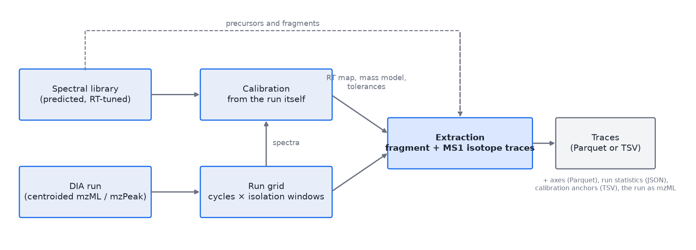
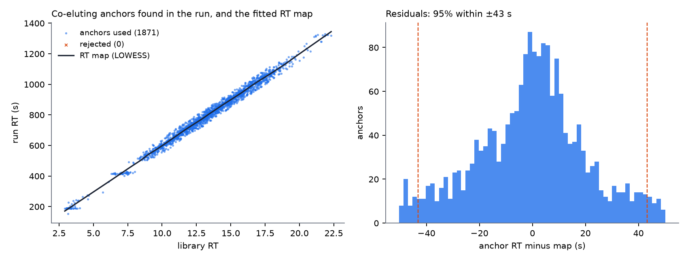
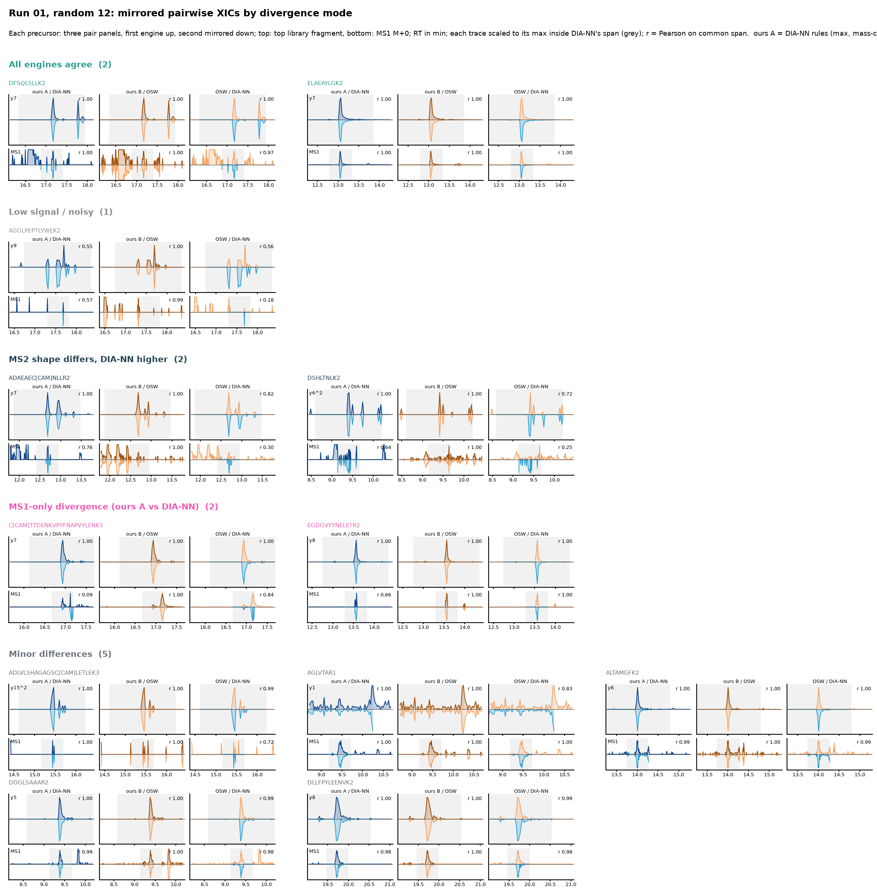
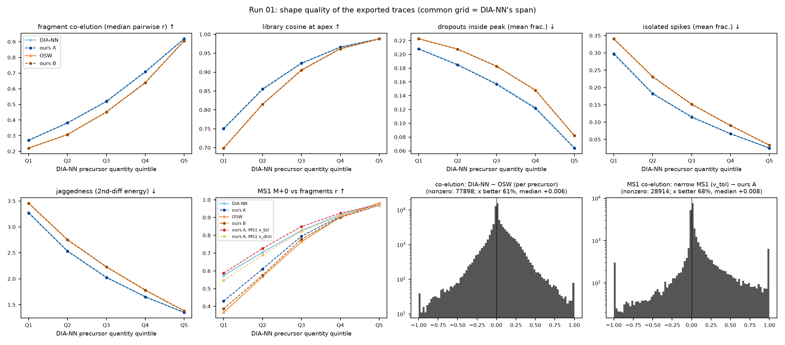
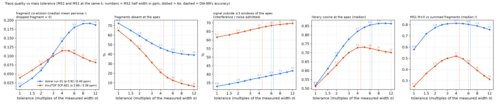
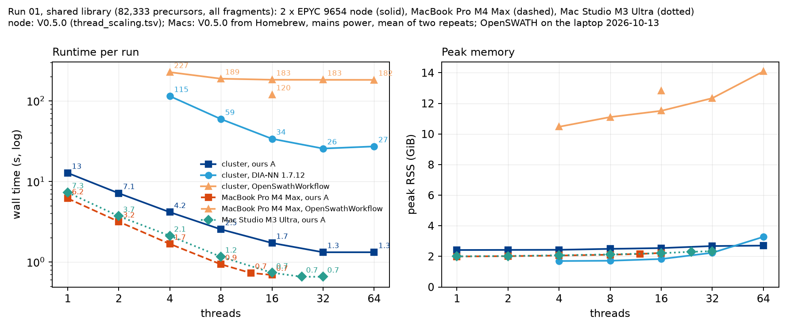

# DIATraceExtractor V0.2.5: release report (2026-10-13)

**Versions.** This report accompanies release **V0.2.5** of `DIATraceExtractor` (okohlbacher/dia-trace-extract-prototype).
The extraction has not changed since V0.2 (commit 663dc39 = cb466f0 + the report); V0.2.1–V0.2.5 added the
`-scheme B` preset, macOS support, three defect fixes and this report's corrections, and every number here was
re-checked against archived runs. Which binary produced which measurement is stated at each table and in
Appendix C: the Astral and diaPASEF quality and speed tables come from cb466f0 (V0.2), the laptop series from
V0.2.2-2-gfff45ea (the laptop's branch, = V0.2.3), the 1- and 2-thread cluster rows from V0.2.4; the earlier
rule comparisons (A-V0.1, P) from the pre-release binaries named in Appendix C.

**What it is.** `DIATraceExtractor` is an OpenMS TOPP tool (C++23, OpenMS develop) that extracts DIA fragment and
precursor-isotope traces (XICs) from a predicted spectral library and writes them as Parquet or TSV. It calibrates
retention time and mass against the run itself, needs no identifications, and does no scoring. This report gathers
what has been measured about the quality of its traces and its speed against DIA-NN 1.7.12 and OpenSWATH on two
instrument classes, an Orbitrap Astral and a timsTOF SCP (diaPASEF), the design decisions those measurements led
to, and what is still open. Details live in the dossier (`00-dossier.md`), the extraction description
(`EXTRACTION.md`) and the backlog (`BACKLOG.md`).

**Verdict in one paragraph.** At equal extraction rules the three tools produce the same traces, on both
instruments; the differences between them are rule choices. Ours are the best-supported ones: a mass offset
measured from the run (every data set here needs it, by 1–5 ppm, and the timsTOF MS1 needs an m/z-dependent one),
tolerances expressed in multiples of the measured error width, and an MS1 window at the corrected m/z, which at
DIA-NN's own width captures 98% of the true signal at 1% interference where DIA-NN's export captures 92% at 5% and
OpenSWATH 100% at 22%. The extraction runs 19–28× faster than DIA-NN and 55–136× faster than OpenSWATH on the same
run and library, in 2.7 GiB, with byte-identical output at 1 and 64 threads and, on run 01, from any of the three
readers (fast mzML, OpenMS mzML, mzPeak); on a MacBook Pro (M4 Max) the same run takes 3.3 s at 16 cores, with
OpenSWATH at 120 s. Two things are open and both concern the width of the window, not its centre: the tolerance
multiple is set per instrument class from an identification screen rather than measured from the run, because the
calibration anchors cannot see the interference that sets the optimum; and the MS1 multiple of 4σ is on the narrow
side (93% of the modelled true signal captured, §4) and should move to 5–6σ once re-screened.

## 1. Data, libraries, references

| | Orbitrap Astral | timsTOF SCP (diaPASEF) |
|---|---|---|
| data set | ProteoBench DIA ion entrapment module: `LFQ_Astral_DIA_15min_50ng_Human_01–03` (PXD070049), 15 min, 50 ng, 5.8 GB mzML each | ProteoBench diaPASEF quantification module: conditions A and B, sample Alpha 01 (PXD062685), 25 ng; `.d` converted to mzPeak, and by this tool to mzML |
| library | DIALibGen (0.11.0, commit 6f26790; libraries named v0.11.1), human (3.5 M precursors) and entrapment (7.0 M); RT model tuned on DIA-NN's IDs of run 01 (`-rt_mode minutes`) | DIALibGen, HYE mixed species, 4.15 M precursors; predicted RT (`-rt_mode auto`) |
| reference traces | DIA-NN 1.7.12 (last open-source version, `--xic` export patched), OpenSwathWorkflow (OpenMS develop) | DIA-NN 1.7.12 on our mzML export (1.7.12 reads no `.d`) |
| restriction for comparisons | DIA-NN's 1% FDR IDs (78–93 k precursors) | DIA-NN's 1% FDR IDs (54,557 A01; 55,665 B01) |

Sources, accessions and converters: Appendix B. DIA-NN exports traces only while searching, so its times include
the search; OpenSWATH's include its scoring.

## 2. How the extraction works



- **Run grid.** Every centroid of the run goes into one memory-mapped pool (m/z as uint32 at 1e-5 Th, intensity as
  float32: 8 bytes per peak), indexed by isolation window and DIA cycle, with MS1 on its own scan axis. Three
  readers feed it: a fast mzML parser, the OpenMS mzML reader, and the mzpeak-openms library for mzPeak files. All
  three order tied centroids identically, so the traces are byte-identical whichever reader loaded the run.
- **Ion mobility (diaPASEF).** A diaPASEF MS2 frame is one spectrum that covers several isolation windows, each
  active over its own 1/K0 band, and holds the centroids of every TIMS scan, so one ion appears once per scan it
  spans. The reader uses the mobility in two steps and then integrates it out: each centroid is assigned to the
  isolation window whose mobility band contains it (the bands come from the frame's precursor descriptions), which
  restores the window selectivity a flat read of the frame would lose; then, within a window, the scans are
  collapsed: centroids within 15 ppm of each other are summed and placed at their intensity-weighted m/z. The grid
  then holds one ordinary spectrum per window and cycle and everything downstream is the same as on the Orbitrap.
  MS1 frames are collapsed over the whole mobility range in the same way. The library's predicted CCS column is not
  used: a precursor's trace integrates every mobility at which its fragments appear inside the window's band.
  The mzML export (`-out_mzml`) hands DIA-NN the same collapsed frames, so the comparisons in §3 are between
  extraction rules, not between mobility treatments. Mobility as an extraction axis (filtering a precursor's
  fragments to its predicted 1/K0, or mobility-resolved traces) is the next step for this instrument class and is
  not part of V0.2.
- **Calibration** (`EXTRACTION.md` §3). A panel of 5% of the library (every k-th row, never the `-ids` subset) is
  searched for co-eluting fragment apexes: a strict first pass over the whole run yields anchors for a robust
  LOWESS RT map; a relaxed second pass within ±max(4σ, 30 s) of the map refines it. The apex centroids of the
  strict anchors give the mass model: a median offset, or a line offset + slope × m/z when the m/z dependence is
  material (new in V0.2; it matters only on the timsTOF MS1, +15 ppm per 1000 Th; on Astral the fitted slopes are
  under 1 ppm per 1000 Th and change nothing measurable, `EXTRACTION.md`), and the error width as 1.4826 × MAD of the residuals. Tolerances are multiples of that width.
- **Extraction.** Each precursor's fragments and MS1 isotopes are extracted within ±60 s of the mapped RT (or a
  measured window, `-rt_window 0`), by a merge join of the sorted target windows against each spectrum's
  centroids, taking the most intense centroid per window (DIA-NN's rule, `-aggregation max`) or their sum
  (OpenSWATH's, `sum`).
- **Output.** Traces as Parquet (`-out`, one row per trace, sharded) or as a long TSV (`-out_tsv`), with the axes
  file (`-out_axes`: global cycle axis, exact acquisition times per window, MS1 scan times), run statistics as
  JSON (`-out_stats`), the calibration anchors as TSV (`-out_calibration`, reusable as `-rt_anchors`), and the
  loaded run as a centroided mzML (`-out_mzml`, one spectrum per isolation window).
- **Scheduling.** One worker pool runs library reading, extraction, encoding and writing as task classes
  rebalanced by pipeline pressure, with in-order issue and an ordered commit, so the output does not depend on
  the thread count.



**The two extraction schemes, A and B.** The reference engines differ in a handful of rules, and the tool can
follow either set, so that each comparison measures the rules and not the implementation:

| rule | A (DIA-NN's rules; the default) | B (OpenSWATH's rules) |
|---|---|---|
| value per spectrum | the most intense centroid in the m/z window (`-aggregation max`) | the sum of all centroids in the window (`sum`); the whole column is one preset, `-scheme B` |
| mass correction | offsets (and the m/z-dependent term) measured from the run (`-mass_calibration auto`) | none: the window sits at the library m/z |
| tolerance | multiples of the measured widths (`-mz_sigma_ms2`, `-mz_sigma_ms1`), or fixed ppm | DIA-NN's optimised MS2 accuracy for both levels, as the benchmark gave OpenSWATH (`-mz_tol`, `-mz_tol_ms1`) |
| MS1 isotopes | M+k at m/z + k · 1.00336 / z | M+k at m/z + k · 1.00336 regardless of charge (`-ms1_isotope_spacing unit`) |
| RT window, MS1 axis | ±60 s around the mapped library RT; MS1 at its own scans | the same |

Scheme B is a single preset (`-scheme B`, V0.2.1) because its three rules were easy to half-apply: once the
measured mass correction became the default, a B command without `-mass_calibration off` extracted at the
corrected m/z, and its parity with OpenSWATH fell from 95% to 64% of MS2 traces at r > 0.9 before this was caught
(Appendix C). Three configurations of A appear below and are named throughout: **A-V0.2**, the defaults of this release
(MS2 9σ, MS1 4σ on Astral); **A-V0.1**, the previous release's fixed rule (MS2 ±6 ppm, MS1 ±2.1 ppm around the
measured offsets), on which the three-way comparison and the shape metrics of §3–§4 were run; and **P** (parity),
A with both tolerances set to DIA-NN's optimised accuracy. Scheme B exists to show that the tool reproduces
OpenSWATH's traces; its rules are not recommended (§4). Everything else is shared: the run grid, the RT map, the
merge join, the output.

## 3. Are the traces the same? (both instruments, DIA-NN's IDs)

**Astral**, run 01, shared tuned library, all 79,953 DIA-NN IDs, every library fragment
(`results/gallery_v02/cmpA.tsv`, `cmpB.tsv` for the V0.2 binary; `results/refined/.../run01/cmpA.tsv`, `cmpP.tsv`
for the earlier rules):

| pair | MS2 median r | MS2 r > 0.9 | MS1 M+0 median r |
|---|---|---|---|
| ours B vs OpenSWATH | 0.9999 | 95.3% | 0.9995 |
| ours P (DIA-NN's tolerances) vs DIA-NN | 1.0000 | 92.0% | 0.954 |
| ours A-V0.1 vs DIA-NN | 1.0000 | 92.0% | 0.978 |
| ours A-V0.2 (defaults) vs DIA-NN | 0.9997 | 83.1% | 0.977 |
| DIA-NN vs OpenSWATH | 0.971 | 62.7% | 0.953 |


(The figure pools runs 01–03 with an earlier configuration, both tolerances at DIA-NN's accuracy and MS1 on the
cycle axis, dossier §2; the shape of the distributions is the point.) Ours B reproduces OpenSWATH nearly exactly;
ours A reproduces DIA-NN at MS2. The two reference engines disagree with each other more than either disagrees
with its matching configuration of ours. The remaining MS2 tail of P against DIA-NN (8% of traces below r = 0.9 in the
table; 3.5% of the traces non-zero in both engines, dossier §3.2) is entirely its float32 quadratic window centre, shifted by about 0.5 ppm from ours: emulating that arithmetic
reproduces DIA-NN's traces in a 3,000-precursor sample with none of 34,923 traces differing at r < 0.99 or
L1 > 0.01 (dossier §3.2). It is a DIA-NN rule choice, and its quadratic describes the true mass error worse than a
constant does. At the defaults, A-V0.2's wider MS2 window (±7.9 ppm against DIA-NN's ±5.9) lowers the share of
traces at r > 0.9 to 83%, by construction of the comparison; §4 shows what the wider window does to the traces
themselves.

**A random sample of the traces, all four arms.** The figure shows 12 of 50 randomly drawn precursors (seed
20261010) as mirrored pairs: ours A-V0.2 against DIA-NN, ours B against OpenSWATH, and OpenSWATH against DIA-NN,
the top library fragment above and MS1 M+0 below, each trace scaled to its maximum inside DIA-NN's exported span
(grey). The full 50 are in `figures/gallery_v02/trace_mirror_random.png`, the same precursors overlaid in
`trace_gallery_by_mode.png`, and one figure per mode in `trace_gallery_mode_*.png`
(`scripts/trace_gallery_features.py`, `trace_gallery.py`, `trace_gallery_mirror.py`).



Each of the 73,350 precursors with traces in all four arms is assigned one divergence mode from the per-trace
metrics (first matching rule wins; thresholds anchored on the B-vs-OpenSWATH re-implementation noise floor):

| mode | share | in the random 50 |
|---|---|---|
| all engines agree | 19.0% | 9 |
| minor differences | 27.1% | 16 |
| MS1 differs, ours A vs DIA-NN (MS2 agrees) | 25.6% | 10 |
| MS2 shape differs, DIA-NN higher | 11.5% | 9 |
| MS2 shape differs, OpenSWATH higher | 3.6% | 1 |
| DIA-NN's XIC span off-centre (truncated common span) | 6.2% | 3 |
| low signal / noisy | 5.9% | 2 |
| scale only (sum vs max) | 1.2% | 0 |

No mode is caused by an RT shift: all engines read the same spectra. The "MS2 shape differs" modes are the
OpenSWATH window centre (§4) and DIA-NN's quadratic centre; the "MS1 differs" mode is DIA-NN's MS1 export at the
uncorrected m/z against our corrected, narrow window (§4), visible in the figure as DIA-NN's MS1 trace carrying
extra peaks ours does not. The galleries were regenerated for this release (the 2026-10-10 versions in
`figures/` show the earlier configuration of the correlation figure).

**timsTOF diaPASEF**, runs A01 and B01, DIA-NN 1.7.12 on our mzML export, top 6 fragments
(`results/diapasef/cmpdef_*.tsv`, `cmpP_*.tsv`; constant mass model, so the MS1 window of the default rows is
4σ of the constant width, ±12.9 / ±12.3 ppm). Calibration finds 775 anchors in this 25 ng sample, MS2 width
2.6–2.7 ppm, MS1 3.2–3.4 ppm (2.2 ppm with the m/z-dependent model, `odia_A01_lin.log`):

| ours vs DIA-NN | MS2 median r | MS2 r > 0.9 | MS1 r > 0.9 |
|---|---|---|---|
| A01, defaults (4σ = ±10.8 ppm) | 0.992 | 86.0% | 63% |
| A01, at DIA-NN's ±11.8 ppm | 0.9993 | 91.7% | 60% |
| B01, defaults (4σ = ±10.6 ppm) | 0.974 | 76.0% | 67% |
| B01, at ±11.8 ppm (DIA-NN: ±12.6) | 0.996 | 89.4% | 66% |

At equal tolerance the engines agree on diaPASEF as on Astral; at the defaults the slightly narrower window costs a
few points, again by construction. The MS1 agreement of 60–67% looked like a defect and is not: where both engines
have signal the values are identical, and each has zeros where the other has signal, so the two windows sit at
different centres. Placing our MS1 window at the uncorrected library m/z with DIA-NN's MS2 accuracy raises the
agreement to 79%, and widening that uncorrected window to ±20 ppm drops it to 43% (`cmp_ms1raw11.8.tsv`,
`cmp_ms1raw20.tsv`): DIA-NN's export rule of §4, visible here because the MS1 offset is 3.4 ppm plus the m/z
slope instead of Astral's 1.3 ppm. Our MS1 traces are the mass-corrected ones.

## 4. Which rules are right? (re-extraction from the raw centroids, 3,000 IDs)

**How this was assessed.** There is no ground truth for a trace, so the rules were judged on the centroids
themselves. For a random sample of 3,000 DIA-NN-identified precursors of Astral run 01, every centroid within
±25 ppm of each fragment and MS1 isotope target was recorded at every point of the trace
(`scripts/quality_reextract.py`, reading the mzML directly). A mass-error model was fitted to the apex centroids
of the top-6 fragments of the confident IDs: a mean μ(m/z, intensity), quadratic in m/z with an upward drift for
strong centroids, and a width σ(intensity) = √(0.83² + 70²/I) ppm, i.e. 2.4 ppm at 10³ and 0.86 ppm at 10⁵. A
centroid is counted as true signal when it lies within 3σ(I) of μ. Each engine's rule (window centre, width, max
or sum) is then applied to the recorded centroids; **capture** is the share of the true signal in the peak region
(apex ±4 cycles) that the rule returns, **interference** the share of what it returns that is not true signal (an
upper bound, since the tails of the error distribution hold real signal too). Shape metrics are computed on the same re-extracted traces: **co-elution** is the mean pairwise Pearson r of a
precursor's fragment traces over ±4 cycles around the apex, **cosine at apex** the cosine between the square-rooted
apex intensities and the library intensities, **dropouts** the share of fragments without signal at the apex. The rule emulation was
validated first: for every engine it reproduces the engine's own exported traces with a median r of 1.0
(`scripts/quality_sample.py`, `scripts/quality_v02_rules.py`, `results/analysis/quality/`; details in
`analysis/trace_quality.md`).

**MS2** (DIA-NN's accuracy ±5.9 ppm; ours A at the V0.2 defaults, 9σ = ±7.9 ppm around the measured offset with
its m/z term):

| rule | capture | interference | co-elution | cosine at apex | dropouts |
|---|---|---|---|---|---|
| ours A (V0.2 defaults, max, ±7.9 ppm) | **99.9%** | 4.7% | 0.521 | 0.920 | 14.8% |
| DIA-NN (quadratic centre, max, ±5.9 ppm) | 99.5% | 2.8% | 0.522 | 0.919 | 14.9% |
| ours B = OpenSWATH (no correction, sum, ±5.9 ppm) | 97.3% | 3.1% | 0.467 | 0.903 | 16.9% |

Ours A and DIA-NN give the same trace shapes; A's wider window trades 1.9 points of interference for the last
0.4% of signal (at ±5.9 ppm around our offset it is 99.6% / 2.9%, indistinguishable from DIA-NN). B's loss is its
centre: with no correction, the ±5.9 ppm window ends only 2.7 ppm beyond the true −3.2 ppm offset. Max versus sum
is irrelevant on Astral MS2: at most 4 × 10⁻⁵ of the points hold two centroids in one window.

**MS1, M+0** (peak region apex ±6 MS1 scans; truth model 3σ(I) around the MS1 median, σ 0.85 ppm):

| rule | capture | interference |
|---|---|---|
| ours A (V0.2 defaults: measured offset with m/z term, max, 4σ = ±1.43 ppm) | 92.6% | **0.0%** |
| ours A at DIA-NN's width (measured offset, ±2.13 ppm) | **98.0%** | 0.9% |
| DIA-NN export (uncorrected m/z, max, ±2.13 ppm) | 91.6% | 5.4% |
| ours B = OpenSWATH (no correction, sum, ±5.9 ppm) | 100% | 22% |

The corrected centre is what matters: at DIA-NN's own width it captures 98% at 0.9% interference where DIA-NN's
uncorrected export captures 92% at 5.4%, and the wide OpenSWATH window admits a quarter of its peak intensity as
interference. The 4σ default is on the narrow side by this truth model: the width measured on the anchors
(0.36 ppm) comes from strong apex centroids, while weak MS1 centroids scatter more (the intensity dependence of
the errors, `EXTRACTION.md`), so ±1.43 ppm leaves 7% of the modelled true signal outside. At ±2.1 ppm around our offset (A-V0.1), MS1-to-fragment co-elution on the exports ranks ours (0.886) above
DIA-NN (0.880) and OpenSWATH (0.826); the 4σ export has not been shape-scored. A 5–6σ MS1 default is the change
this points at. OpenSWATH additionally places isotope k at m/z + k·1.00336 without
dividing by the charge, so its M+1 and M+2 traces of charge ≥ 2 precursors are a different ion.



## 5. Trace quality as a function of the tolerance (both instruments)



The DIA-NN-identified precursors of each run extracted at k × σ, k = 1 … 12, and scored on the traces
(`scripts/tolerance_screen.py`; σ as measured by the calibration of the time, with the constant mass model: Astral
0.92 / 0.40 ppm, timsTOF 2.66 / 3.38 ppm for MS2 / MS1):

| | MS2 co-elution optimum | MS1 co-elution optimum | DIA-NN's own accuracy |
|---|---|---|---|
| Astral run 01 | k = 8–10 (±7.4–9.2 ppm) | k = 4 (±1.6 ppm) | 6.4σ (±5.9 ppm) |
| timsTOF A01 | k = 4–5 (±10.6–13.3 ppm) | k = 4 (±13.5 ppm) | 4.4σ (±11.8 ppm) |

On Astral the MS2 curve saturates (heavy error tail, dropouts keep falling); on timsTOF it peaks and falls
(Gaussian errors, interference costs beyond 5σ). DIA-NN's optimised accuracy sits at each instrument's optimum.
The screen's Astral MS2 σ of 0.92 is the constant model's; the V0.2 linear model gives 0.88, hence ±7.9 ppm for 9σ
in §3–§4. MS1 peaks at 4σ on both instruments, but the timsTOF MS1 width has since dropped from 3.38 to 2.2 ppm
with the m/z-dependent model, so the same ±13.5 ppm optimum is 6σ of the new width: the MS1 multiple has to be
re-screened (§4).

**Can the calibration find the multiple by itself?** Not as a rule. The anchors' own co-elution curve does peak
at the Astral optimum (k = 8), but every anchor-based criterion tried rises monotonically to 8σ on timsTOF too: the all-fragment co-elution curve of the anchors, the same on the weaker half of the anchors, on
their weak fragments only, and on both; and the anchor yield at a 1% decoy-calibrated false rate, which the
shifted-fragment decoys make meaningless (0–5 decoys per run). Anchors are present precursors whose fragments stay
correlated as the window widens; the screen's optimum comes from interference in weak and absent precursors, a
population the calibration does not have. **Decision:** the multiples are set per instrument class from the run's
metadata (MS2 9σ Orbitrap/Astral, 4σ timsTOF and other TOF, 6σ with a warning when unknown; MS1 4σ), as explicit
options (`-mz_sigma_ms2`, `-mz_sigma_ms1`; `-mz_tol*` for fixed ppm). A measured criterion needs a population
containing absent peptides, i.e. peptide decoys from the library generator (backlog).

## 6. Performance

Machine: 2 × AMD EPYC 9654 (56 cores per socket online, SMT), shared node; inputs on local `/scratch`; one run per
point unless stated; peak RSS from `/usr/bin/time`.

**Runtime vs threads**, Astral run 01, shared tuned library (82,333 precursors, all fragments); ours at the V0.2
defaults (commit cb466f0), DIA-NN and OpenSWATH from the same series with unchanged binaries:


| threads | ours A (defaults) | ours B (OpenSWATH rules) | DIA-NN 1.7.12 | OpenSwathWorkflow |
|---|---|---|---|---|
| 1 | 13.8 s / 2.3 GiB | 11.9 s / 2.4 GiB | – | – |
| 2 | 6.9 s | 6.7 s | – | – |
| 4 | 4.1 s / 2.4 GiB | 4.1 s / 2.4 GiB | 115 s / 1.7 GiB | 227 s / 10.5 GiB |
| 8 | 2.5 s | 2.4 s | 59 s | 189 s |
| 16 | 1.7 s | 1.6 s | 34 s | 183 s |
| 32 | 1.3 s | 1.3 s | 26 s | 183 s |
| 64 | 1.4 s / 2.6 GiB | 1.3 s / 2.7 GiB | 27 s / 3.3 GiB | 182 s / 14.1 GiB |

Ours is 28× faster than DIA-NN at 4 threads and 19–20× from 16 threads up, and 55–136× faster than OpenSWATH.
Ours flattens beyond 32 threads at this library size: the tool's own stages take about 1.0 s (ingest 0.3 s,
calibration 0.1 s, extraction 0.4 s), the remaining 0.3–0.4 s is process start-up and teardown; B, which skips
the calibration, is 0.1 s faster. OpenSWATH stops scaling at 8 threads while its memory grows to 14 GiB. Shared
node (load 5–15 from other users); ours read the inputs from local disk, the references from the network file
system (Appendix C). The 1- and 2-thread rows were measured with the V0.2.4 binary after the one-thread ingest fix
described below; the references were not run below 4 threads.

**Full libraries**, Astral run 01, 64 threads, top 6 fragments, V0.2 defaults:

| library | tool total (wall incl. start-up), 2 runs | calibration | extraction | peak RSS | traces |
|---|---|---|---|---|---|
| human, 3.49 M precursors | 5.6–5.9 s (6.2–6.4 s) | 0.5 s | 3.3–3.4 s | 3.8 GiB | 31.3 M |
| entrapment, 7.0 M precursors | 9.1 s (9.7 s) | 1.0 s | 6.1–6.2 s | 4.8 GiB | 63.0 M |

Measured at a node load of about 21; an earlier commit (6d26c49) measured 8.6–9.0 s on the entrapment library on a
quieter node (dossier §4). The thread table above uses `/usr/bin/time` wall clock, this one the tool's own total.

**diaPASEF** (A01, 4.15 M-precursor library, 32 threads, `results/diapasef/odia_A01.log`): 45 s wall, 17 GB peak
RSS (13.8 GB with the regenerated library, `odia_A01_regenlib.log`), 36.7 M traces; the mzPeak per-spectrum read
and the mobility collapse take 26 s of it, the calibration 5 s, the extraction 13 s.

**On a laptop** (MacBook Pro, Apple M4 Max: 12 performance + 4 efficiency cores, no SMT, 128 GiB, macOS 26.6,
inputs on the internal SSD, Homebrew libomp; Appendix C). Same run and shared library, mean of two repeats, run on
battery without visible throttling (repeat 2 within 7% of repeat 1):



| threads | ours A | ours B | OpenSwathWorkflow |
|---|---|---|---|
| 1 | 41.4 s / 2.0 GiB (serial parser, see below) | 41.3 s | – |
| 2 | 5.4 s | 5.2 s | – |
| 4 | 4.4 s | 4.3 s | – |
| 8 | 3.9 s | 3.9 s | – |
| 12 (performance cores) | 3.8 s | 3.8 s | – |
| 16 | 3.3 s / 2.1 GiB | 3.4 s / 2.2 GiB | 120 s / 12.7 GiB |

The full 7.0 M-precursor library takes 14.9–15.7 s at 16 threads in 3.9 GiB. Per core the laptop is the faster
machine (OpenSWATH: 120 s at 16 cores against 183 s on the node), while ours flattens from 8 cores on: the ingest
of the 5.8 GB mzML is page-fault-bound on macOS (2.9 s of the 3.3 s at 16 threads, with 19–23 s of system time;
on the node the same ingest takes 0.4 s), which was not investigated further. The laptop needed no change to the
extraction but exposed three defects, all present on Linux too; the first two were fixed on the laptop (tag
V0.2.3), the third here (V0.2.4):

- `--help` aborted (an unregistered TOPP subsection, since `calibration:mass_model` became a visible option on
  2026-10-12; `--helphelp` had aborted on every build);
- every run aborted after writing its output, because OpenMP workers hand their thread-local buffer caches back
  to a pool that a static destructor had already torn down; glibc tolerates the dead mutex, libc++ throws. The
  pool is now never destroyed;
- `-threads 1` fell back to the serial OpenMS mzML parser instead of the chunk parser with one worker: 70 s
  instead of 14 s on the node for the shared library (`results/threads_cb466f0/t1/odiaA_serial_parser.log` vs
  `odiaA.log`). The laptop's 41 s at 1 thread was measured before this fix and has not been re-run.

**What the speed rests on** beyond the design of §2 (dossier §4, `06-parallel-efficiency.md`,
`07-contention-diagnosis.md`): the parsers decode straight into the peak pool; a bucket index over m/z skips
gaps in the merge join; trace and Arrow buffers are recycled with a per-thread cache; 32 Parquet parts are written
by their own tasks. The library-load transient (decoded row groups, parts and the joined copy coexisting) and the mzPeak reader's serialised decode (scales to 10–14 cores) are the known remaining
costs.

## 7. Reproduction

- Code: https://github.com/okohlbacher/dia-trace-extract-prototype, release tag `V0.2.5` (this report is attached to
  the release); build instructions in Appendix A, data sources in Appendix B, command lines in Appendix C.
- Benchmarks: `scripts/benchmark_refined.sh` (three-way comparison on a shared recalibrated library),
  `scripts/bench_threads.sh` (thread series), `scripts/bench_macos.sh` (laptop), `scripts/plot_machine_scaling.py`, `scripts/compare_traces.py` (pairwise metrics),
  `scripts/quality_reextract.py`, `quality_sample.py` and `quality_v02_rules.py` (§4), `scripts/tolerance_screen.py`
  and `plot_tolerance_screen.py` (§5), `scripts/plot_thread_scaling.py` (§6), `scripts/doc_figures.py` (§2 figures).
  Mass-error dumps: `ODIA_DUMP_MASS_ERRORS=file`.
- Inputs: Appendix B; libraries in `library/` (DIALibGen 0.11.0 + 6f26790, `library/generate.sh`, `library/hye_timstof.log`).
- Tests: `ctest` in the build directory (7 tests: TraML extraction, OpenSWATH parity, byte-level Parquet compare).

## Appendix A: repository and installation

**Repository.** https://github.com/okohlbacher/dia-trace-extract-prototype, tag `V0.2.5`. History: V0.2 (663dc39) the
extraction as benchmarked; V0.2.1 the `-scheme` preset; V0.2.2 macOS portability; V0.2.3 the `--help` and exit-time
fixes (laptop branch); V0.2.4 the one-thread ingest fix and the laptop results; V0.2.5 this report's version stamp. The mzPeak reader is the submodule `external/mzpeak` (okohlbacher/mzpeak-openms, tag
`partitioned-read-2026-10-11`); the library generator is okohlbacher/DIALibGen (0.11.0, commit 6f26790 on branch
`compact-parquet-plain-strings`, which also carries the build fix for current OpenMS develop).

**Requirements.** Linux, GCC ≥ 13, CMake ≥ 3.24, Ninja; an OpenMS develop (≥ 3.7) build tree with its vcpkg
dependencies, which provide Arrow/Parquet and, with `boost-json` and `boost-program-options` added to the OpenMS
vcpkg manifest, the Boost ≥ 1.89 the mzPeak library needs (another `BoostConfig.cmake` directory can be given with
`-DMZPEAK_BOOST_DIR`). Python 3 with pyarrow, pandas, numpy and matplotlib (`tools/pyenv` here) for the scripts;
`markdown` and `weasyprint` for the PDF.

```bash
git clone https://github.com/okohlbacher/dia-trace-extract-prototype.git && cd dia-trace-extract-prototype
git checkout V0.2.5
git submodule update --init
# OpenMS develop, built with its vcpkg manifest (here at OpenMS/OpenMS-build via `cmake --preset linux-x64-release`)
O=$PWD/OpenMS/OpenMS-build
cmake -S . -B build -G Ninja -DCMAKE_BUILD_TYPE=Release -DCMAKE_PREFIX_PATH="$O;$O/vcpkg_installed/x64-linux-dynamic"
cmake --build build -j 16
ctest --test-dir build        # 7 tests: TraML extraction, OpenSWATH parity, byte-level Parquet compare
```

**macOS (Apple silicon).** Supported since V0.2.2 (the Linux-only calls are guarded). `scripts/bench_macos.sh`
builds OpenMS develop (its `macos-arm64-release` preset, Homebrew libomp; 1–3 h the first time) and the tool, fetches
the inputs and runs the benchmark, one phase at a time or `all`; the ctest suite passes on macOS (7/7).

**Use.**

```bash
# defaults: RT map, mass offsets and tolerances measured from the run; +-60 s around the library RT
# (-rt_mode minutes: tuned libraries carry run minutes; auto: predicted RT, the map is fitted from the run)
build/DIATraceExtractor -in run.mzML -lib library.parquet -rt_mode minutes -threads 64 \
  -out traces.parquet -out_stats stats.json -out_calibration anchors.tsv
build/DIATraceExtractor -in run.mzpeak -lib library.parquet -rt_mode auto -threads 64 -out traces.parquet
build/DIATraceExtractor -in run.mzpeak -out_mzml run.mzML            # the loaded run as centroided mzML, for other tools
build/DIATraceExtractor --help                                       # all options, including calibration:*
```

Input formats: mzML (indexed, centroided) and mzPeak; libraries as DIALibGen compact Parquet, DIA-NN/OpenSWATH TSV,
TraML or PQP.

## Appendix B: data sets

**Orbitrap Astral (ProteoBench DIA ion entrapment module).** Three single-species human runs of the "LFQ Benchmark
Dataset - Generation Beta" (Van Puyvelde et al., Dhaenens lab, Ghent; ProteomeXchange **PXD070049**,
https://www.ebi.ac.uk/pride/archive/projects/PXD070049): `LFQ_Astral_DIA_15min_50ng_Human_01/02/03.raw`, Orbitrap
Astral, 15-min gradient, 50 ng. ProteoBench mirrors them with the module's search database:

| file | source |
|---|---|
| `LFQ_Astral_DIA_15min_50ng_Human_01.raw` (3.1 GB), `_02.raw`, `_03.raw` | https://proteobench.cubimed.rub.de/raws/DIA-astral-entrapment/ (also `all_data_Entrapment_DIA_Astral.tar.gz`, 5.6 GB) |
| `ProteoBenchFASTA_Entrapment_Human_with_contaminants_entrapment_pep.zip` (2,841,736 peptide-level entries: human targets, contaminants and entrapment peptides, 1:1) | https://proteobench.cubimed.rub.de/fasta/ |
| `UP000005640_9606.fasta` (UniProt human reference proteome, 20,652 entries; the human library) | https://www.uniprot.org/proteomes/UP000005640 |

The `.raw` files were converted to centroided, indexed mzML with OpenMS `FileConverter` from the same OpenMS
develop build (Thermo raw read through its ThermoRawFileParser bridge, vendor centroiding;
`benchmark-data/DIA-astral-entrapment/mzML/convert_*.log`); mzPeak variants were made with mzpeak-convert
0.17.2 / 0.18.0 and with this tool's `MzMLToMzPeak`.

**timsTOF SCP diaPASEF (ProteoBench DIA quantification, precursor-ion level, diaPASEF module).** Three-species
mixture (human, yeast, E. coli commercial digests in the proportions of Van Puyvelde et al., 2022, Scientific Data
9:126, https://www.nature.com/articles/s41597-022-01216-6; expected log2 A/B: human 0, yeast −1, E. coli +2),
25 ng in triplicate, Bruker timsTOF SCP with an UltiMate 3000 RS nanoLC and a 25 cm IonOpticks Aurora column,
diaPASEF with precursor m/z 400–1000, 1/K0 0.64–1.37, 0.96 s cycle. ProteomeXchange **PXD062685** (announced by
the module; at the time of writing the files are served by ProteoBench):

| file | source |
|---|---|
| `ttSCP_diaPASEF_Condition_A_Sample_Alpha_01_11494.d.zip` (7.3 GB), `..._Condition_B_Sample_Alpha_01_11496.d.zip` (7.1 GB); replicates 02/03 of both conditions available, not used | https://proteobench.cubimed.rub.de/raws/diaPASEF/ |
| `ProteoBenchFASTA_MixedSpecies_HYE.zip` (31,889 entries: three proteomes plus contaminants prefixed `Cont_`, Frankenfield et al., J. Proteome Res. 2022) | https://proteobench.cubimed.rub.de/fasta/ProteoBenchFASTA_MixedSpecies_HYE.zip |

The `.d` folders were converted with mzpeak-convert 0.18.0 (`benchmark-data/diaPASEF/convert_*.log`); the mzML
files DIA-NN read are this tool's `-out_mzml` export of the loaded grid.

**Reference software.** DIA-NN 1.7.12 (https://github.com/vdemichev/DiaNN, release 1.7.12, the last open-source
version; built here with a one-line fix to its `--xic` export, `tools/DiaNN-1.7.12/`); OpenSwathWorkflow from the
OpenMS develop build used for the tool itself; DIALibGen 0.11.0 + 6f26790 (https://github.com/okohlbacher/DIALibGen) with
AlphaPeptDeep ONNX models for the predicted libraries.

## Appendix C: command lines

Paths: `$P` = the repository, `$S` = `/scratch/$USER/odia-bench` (inputs staged from `benchmark-data/` and
`library/`), `$X` = `build-stream/DIATraceExtractor` at the commit named, `$DIANN` =
`tools/DiaNN-1.7.12/diann-1.7.12-xicfix`, `$OSW` = `OpenMS/OpenMS-build/bin/OpenSwathWorkflow`. The libraries in
each tool's format come from `scripts/lib_to_diann17_tsv.py` (`--rt_scale 1`) and `scripts/lib_to_openswath_tsv.py`
(`--rt_scale 60`). DIA-NN's XICs are converted with `scripts/diann17_xic_to_parquet.py`, OpenSWATH's with
`TextExporter -xic:mode explode`; the pairwise metrics come from `scripts/compare_traces.py`.

**Astral, three-way comparison on the shared tuned library (§3, §4; `RECAL=tuned
LIB=library/proteobench_entrapment_astral_nce25_v0.11.1_tuned_run01.parquet X=build-stream/DIATraceExtractor
scripts/benchmark_refined.sh 01|02|03 64`, binary cbad9dd, A-V0.1 for ours A).** Run 01 shown; runs 02 and 03 differ only in the run and the library's
`_ids_runNN` suffix.

```bash
# DIA-NN 1.7.12, round 1 on the predicted library (gives the IDs that restrict the shared library), then round 2 with XICs
$DIANN --f $S/input/LFQ_Astral_DIA_15min_50ng_Human_01.mzML --lib library/diann17/proteobench_entrapment_astral_nce25_v0.11.1_tuned_run01.tsv \
       --out report.tsv --temp temp --threads 64 --verbose 1 --qvalue 0.01
$DIANN --f $S/input/LFQ_Astral_DIA_15min_50ng_Human_01.mzML --lib lib_diann17.tsv --out report.tsv --temp temp \
       --threads 64 --verbose 1 --qvalue 0.01 --xic 60
# ours A-V0.1 (MS2 +-6 ppm, MS1 measured), ours P (DIA-NN parity: both tolerances = DIA-NN's 5.9051 ppm), ours B (OpenSWATH rules)
$X -in $S/input/LFQ_Astral_DIA_15min_50ng_Human_01.mzML -lib library/refined/proteobench_entrapment_astral_nce25_v0.11.1_tuned_run01_ids_run01.parquet \
   -rt_mode minutes -rt_window 60 -top_fragments 0 -mz_tol 6 -mz_tol_ms1 0 -aggregation max -mass_calibration auto -threads 64 -out odiaA.parquet -out_stats odiaA.json
$X ... -mz_tol 5.9051 -mz_tol_ms1 5.9051 -aggregation max -mass_calibration auto -threads 64 -out odiaP.parquet
$X ... -mz_tol 5.9051 -mz_tol_ms1 5.9051 -scheme B -threads 64 -out odiaB.parquet        # V0.2.1; before: -mass_calibration off -aggregation sum -ms1_isotope_spacing unit
# OpenSwathWorkflow (full window = 2 x DIA-NN's accuracy)
$OSW -in benchmark-data/DIA-astral-entrapment/mzML/LFQ_Astral_DIA_15min_50ng_Human_01.mzML -tr lib_openswath.tsv -out_chrom osw.xic -out_features osw.featureXML \
     -rt_extraction_window 120 -mz_extraction_window 11.8102 -mz_extraction_window_unit ppm -mz_extraction_window_ms1 11.8102 -mz_extraction_window_ms1_unit ppm \
     -ms1_isotopes 2 -Calibration:auto_irt:enabled false -threads 64
```

**Astral, runtime vs threads (§6; `ODIA_ONLY=1 REF=results/threads scripts/bench_threads.sh results/threads_cb466f0 4 8 16 32 64`,
binary cb466f0; 1 and 2 threads added with V0.2.4).** `$t` = 1 … 64; DIA-NN and OpenSWATH as above with `--threads $t` /
`-threads $t` (`results/threads/`, unchanged binaries, reading the mzML from `benchmark-data/` on the network file
system rather than `$S`).

```bash
# ours A: the V0.2 defaults (tolerances by instrument class, m/z-dependent offset when material)
$X -in $S/input/LFQ_Astral_DIA_15min_50ng_Human_01.mzML -lib $S/input/proteobench_entrapment_astral_nce25_v0.11.1_tuned_run01_ids_run01.parquet \
   -rt_mode minutes -rt_window 60 -top_fragments 0 -threads $t -out $S/out/t$t/odiaA.parquet
# ours B
$X ... -rt_mode minutes -rt_window 60 -top_fragments 0 -mz_tol 5.9051 -mz_tol_ms1 5.9051 -scheme B -threads $t -out $S/out/t$t/odiaB.parquet
```

**Astral, full libraries (§6; `results/full_cb466f0/`, binary cb466f0, top 6 fragments, 2 runs each).**

```bash
$X -in $S/input/LFQ_Astral_DIA_15min_50ng_Human_01.mzML -lib library/human_UP000005640_astral_nce25_v0.11.1_tuned_run01.parquet -rt_mode minutes -threads 64 -out $S/out/full_human.parquet
$X -in $S/input/LFQ_Astral_DIA_15min_50ng_Human_01.mzML -lib $S/input/proteobench_entrapment_astral_nce25_v0.11.1_tuned_run01.parquet -rt_mode minutes -threads 64 -out $S/out/full_entrap.parquet
```

**Astral, trace galleries and the V0.2 pair table (§3; `results/gallery_v02/`, binary cb466f0; rule B as
`-scheme B`, §2).**

```bash
$X -in $S/input/LFQ_Astral_DIA_15min_50ng_Human_01.mzML -lib $S/input/proteobench_entrapment_astral_nce25_v0.11.1_tuned_run01_ids_run01.parquet \
   -rt_mode minutes -rt_window 60 -top_fragments 0 -threads 32 -out results/gallery_v02/odiaA.parquet -out_stats results/gallery_v02/odiaA.json
$X ... -mz_tol 5.9051 -mz_tol_ms1 5.9051 -scheme B -threads 32 -out results/gallery_v02/odiaB.parquet
tools/pyenv/bin/python scripts/compare_traces.py --odia results/gallery_v02/odiaA.parquet --axes results/gallery_v02/odiaA.axes.parquet \
    --diann results/gallery_v02/diann/diann_xic.parquet --openswath results/gallery_v02/osw_traces.parquet --out results/gallery_v02/cmpA.tsv
tools/pyenv/bin/python scripts/trace_gallery_features.py results/gallery_v02 results/analysis/gallery_v02/features_run01.parquet
tools/pyenv/bin/python scripts/trace_gallery.py results/gallery_v02 results/analysis/gallery_v02/features_run01.parquet docs/figures/gallery_v02 results/analysis/gallery_v02/gallery_run01
tools/pyenv/bin/python scripts/trace_gallery_mirror.py results/gallery_v02 results/analysis/gallery_v02/gallery_run01_selection.tsv docs/figures/gallery_v02 --sample random
```

**Laptop series (§6; `scripts/bench_macos.sh bench`, binary V0.2.2-2-gfff45ea = V0.2.3 minus the note,
`OMP_WAIT_POLICY=PASSIVE`; machine and defects: `docs/12-macos-benchmark-note.md`).** The same
ours A / ours B commands as the thread series with `$t` in 1 2 4 8 12 16, timed with `/usr/bin/time -l`; the full
library at 16 threads; `RUN_OSW=1` for the OpenSwathWorkflow run (same options, `-threads 16`). Results:
`results/macos-benchmark/` (tarball and `bench.log`), summarised in `docs/figures/laptop_m4max_summary.tsv`.

**Astral, mass-error structure and the linear-vs-constant check (`EXTRACTION.md`, mass model; binary 4e89acc and its parent).**

```bash
ODIA_DUMP_MASS_ERRORS=astral01.tsv $X -in $S/input/LFQ_Astral_DIA_15min_50ng_Human_01.mzML -lib $S/input/proteobench_entrapment_astral_nce25_v0.11.1_tuned_run01.parquet -rt_mode minutes -threads 48 -out ...
$X -in $S/input/LFQ_Astral_DIA_15min_50ng_Human_01.mzML -lib library/refined/proteobench_entrapment_astral_nce25_v0.11.1_shared_run01.parquet -rt_mode minutes -ids results/tolscreen/astral_run01_ids.txt -threads 32 -out astral01_lin.parquet
$X ... -calibration:mass_model constant -out astral01_const.parquet
```

**Tolerance screen (§5; `scripts/tolerance_screen.py`, binary 4934ea5).** The script runs the extractor once per k
with `-mz_tol k*sigma_ms2 -mz_tol_ms1 k*sigma_ms1 -top_fragments 0 -ids ...` and scores the traces.

```bash
tools/pyenv/bin/python scripts/tolerance_screen.py --run $S/input/LFQ_Astral_DIA_15min_50ng_Human_01.mzML \
    --lib library/refined/proteobench_entrapment_astral_nce25_v0.11.1_shared_run01.parquet --ids results/tolscreen/astral_run01_ids.txt \
    --sigma-ms2 0.92 --sigma-ms1 0.40 --rt_mode minutes --out results/tolscreen/astral_run01
tools/pyenv/bin/python scripts/tolerance_screen.py --run $S/input/diapasef/A01.mzpeak --lib library/hye_timstof.parquet --ids results/diapasef/diann_A01_ids.txt \
    --sigma-ms2 2.66 --sigma-ms1 3.38 --rt_mode auto --out results/tolscreen/timstof_A01
tools/pyenv/bin/python scripts/plot_tolerance_screen.py docs/figures/tolerance_screen "Astral run 01=results/tolscreen/astral_run01.tsv:6.4" "timsTOF A01=results/tolscreen/timstof_A01.tsv:4.4"
```

**timsTOF diaPASEF (§3, §6; `results/diapasef/`).** `.d` to mzPeak with mzpeak-convert 0.18.0; the mzML for DIA-NN is
this tool's export of the loaded grid; `B01` identical with the B-condition files.

```bash
/ceph/ibmi/abi/oliver/bin/mzpeak-convert ttSCP_diaPASEF_Condition_A_Sample_Alpha_01_11494.d -o A01.mzpeak
$X -in $S/input/diapasef/A01.mzpeak -out_mzml $S/input/diapasef/A01.mzML -threads 32           # frames split per window, TIMS scans collapsed within 15 ppm
$DIANN --f $S/input/diapasef/A01.mzML --lib library/diann17/hye_timstof.tsv --out report.tsv --temp temp --threads 32 --verbose 1 --qvalue 0.01 --xic 60
# ours, all precursors (cost figures; `-out_calibration` for the anchors), then on DIA-NN's IDs at the defaults (4 sigma) and at DIA-NN's accuracy
$X -in $S/input/diapasef/A01.mzpeak -lib library/hye_timstof.parquet -rt_mode auto -threads 32 -out odia_A01.parquet -out_stats odia_A01.json -out_calibration odia_A01.anchors.tsv
$X -in $S/input/diapasef/A01.mzpeak -lib library/hye_timstof.parquet -rt_mode auto -ids results/diapasef/diann_A01_ids.txt -threads 32 -out odia_A01_idsdef.parquet
$X ... -ids results/diapasef/diann_A01_ids.txt -mz_tol 11.8 -mz_tol_ms1 11.8 -threads 32 -out odia_A01_idsP.parquet
# MS1 window probe around our offset (+-4, 7, 20, 30 ppm) and the uncorrected-centre test that explains DIA-NN's MS1 export
$X ... -ids results/diapasef/diann_A01_ids.txt -mz_tol 11.8 -mz_tol_ms1 7 -out odia_A01_ms1_7.parquet
$X -in $S/input/diapasef/A01.mzpeak -lib library/hye_timstof.parquet -rt_mode auto -mass_calibration off -mz_offset -4.6 -mz_tol 10.8 -mz_offset_ms1 0 -mz_tol_ms1 11.8 \
   -ids results/diapasef/diann_A01_ids.txt -threads 24 -out timstof_A01_ms1raw11.8.parquet
```

**Libraries.** `library/generate.sh human|entrapment` (DIALibGen, Astral NCE 25); the timsTOF library as
recorded in `library/hye_timstof.log`; the tuned RT models with `DIALibGen -mode tune` on DIA-NN's run-01 IDs
(`library/*.log`); the `_ids_runNN` and `_shared_runNN` libraries with `scripts/filter_library.py` on DIA-NN's
report (`scripts/benchmark_refined.sh`, step 2).
