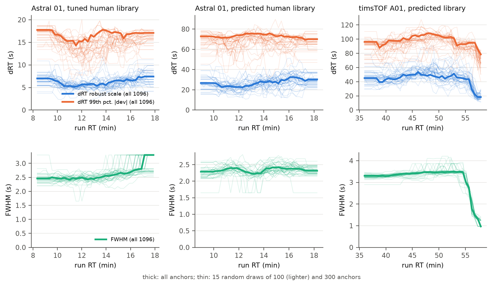

# RT-window estimation: how many anchors, what sets the width, and whether to re-extract (2026-10-20)

The window (`-rt_window 0`, the default) is measured from the calibration anchors, per RT bin of about 150 anchors (at
most 8, linear in between): **7 × the robust scatter (1.4826 MAD) of the anchors' apex RT about the RT map + 2 × their
median peak width (FWHM)**. Data: the ten benchmark configurations of `results/rtwin/all/` (Astral runs 01–03 with
tuned libraries, Astral 01 with the predicted entrapment and human libraries, timsTOF A01/B01 with the predicted
library) and their DIA-NN 1.7.12 IDs at 1% FDR. Scripts and tables: `results/rtwin/converge/` (not in git).

## How many anchors does the window need?

Random subsets of each configuration's anchors (100 draws per size), the window computed as the tool does, scored by
the share of DIA-NN's whole peaks [RT.Start, RT.Stop] inside it (`converge.py`, figure a, b):

| anchors | median deviation from the all-anchor window | coverage, mean of configurations | coverage, worst configuration's 5th-percentile draw |
|---|---|---|---|
| 25 | 18% | 99.70% | 95.2% |
| 100 | 11% | 99.81% | 96.8% |
| 300 | 9% | 99.69% | 97.0% |
| 600 | 6% | 99.74% | 97.2% |
| 1000 | 4% | 99.77% | 97.9% |
| all (710–2,652) | – | 99.4–100% | – |

The typical window is robust (7σ is generous), but small samples miss the tails in some draws, and below 300 anchors
the rule has one RT bin, so the window's dependence on RT is lost (figure c: the narrowing at the end of the timsTOF
gradient, ±357 → ±130 s, needs all 775 anchors). The configurations have 700–2,650 anchors: about what the coverage
needs, not a surplus to subsample.

## The panel: time against anchors

The anchors come from a panel of 5% of the library (two search stages). Smaller panels, one run each (`panel.sh`):

| configuration | panel | anchors | calibration | RT window |
|---|---|---|---|---|
| Astral 01, predicted entrapment (7.0 M) | 350 k / 175 k / 88 k / 44 k / 22 k | 2,652 / 1,279 / 682 / 328 / failed | 1.19 / 0.70 / 0.49 / 0.29 s | ±214–319 / ±195–368 / ±209–286 / ±167–223 s |
| Astral 01, predicted human (3.5 M) | 174 k / 87 k / 44 k / 22 k / 11 k | 1,839 / 952 / 481 / 258 / failed | 0.59 / 0.36 / 0.27 / 0.17 s | ±159–225 / ±151–255 / ±163–221 / ±212 (1 bin) s |
| timsTOF A01 (4.15 M) | 208 k / 104 k / 52 k / 26 k | 775 / 321 / 118 / failed | 4.51 / 4.24 / 2.29 s | ±130–357 / ±228–309 / ±150 (1 bin) s |
| timsTOF B01 | 208 k / 104 k / 52 k / 26 k | 710 / 362 / 170 / failed | 4.20 / 3.78 / 2.03 s | ±122–306 / ±258–324 / ±217 (1 bin) s |

The calibration is 7–8% of a run (Astral 7 M: 1 s of 12.5 s; timsTOF: 4.5 s of 52–64 s), and shrinking the panel buys
little of it: on Astral 0.5–0.9 s at the cost of half to three quarters of the anchors, on timsTOF nothing at half the
panel (4.5 → 4.2 s; the first stage scans the whole run per isolation window, with only 24 windows to parallelise over)
and 2 s at a quarter, where the window has collapsed to one RT bin. At 1/8 (timsTOF) and 1/16 (Astral) the calibration
fails (fewer than 50 first-stage anchors). The default panel stays.

A non-change measured on the way: the second stage also re-extracts every anchor at 2–8 σ for a co-elution curve that
only chooses the MS2 multiple when no instrument file sets it. Skipping it saved nothing measurable (0.96 vs 1.03 s,
4.81 vs 4.77 s; outputs identical), so it stays.

## What sets the width

| configuration | 7 σ (s) | 2 FWHM (s) | FWHM share of the window |
|---|---|---|---|
| Astral, tuned entrapment library | 57–111 | 3.3–6.6 | 7% |
| Astral, tuned human library | 35–69 | 3.3–6.6 | 12–13% |
| Astral, predicted libraries | 157–315 | 3.3 | 1–2% |
| timsTOF, predicted library | 119–349 | 1.9–7.7 | 2% |

The window is the RT map's error, not peak broadening: peaks are 1–5 s wide (anchors' FWHM, 5th–95th percentile),
the scatter of their apexes about the map is 5–50 s. Measuring the FWHM on all extracted traces would refine a term
worth 1–13% of the window, and could only be done after the extraction the window is for. What narrows the window is
a better RT prediction: a tuned library has a third of a predicted one's window (§2 of the release report).

## Extract narrow, re-extract where needed?

For narrower rules (k σ + 2 FWHM), the share of DIA-NN's peaks fully inside, cut at the window's edge (visible, so a
second pass could widen those traces) or fully outside (invisible: lost) (`adaptive.py`):

| rule | lost, worst / mean configuration | at the edge (recoverable), worst | window width vs 7 σ |
|---|---|---|---|
| 3 σ | 6.2% / 1.7% | 4.3% | 47% |
| 4 σ | 4.7% / 0.9% | 2.0% | 60% |
| 5 σ | 3.2% / 0.5% | 0.9% | 73% |
| 7 σ (default) | 0.27% / 0.06% | 0.3% | 100% |

The misses are mostly complete: the map's error has heavy tails, a precursor it places far off leaves nothing in a
narrow window to trigger a second pass. Re-extracting edge cases would recover at most the middle column. Reusing the
calibration's own traces is no shortcut either: they cover 5% of the precursors, with the search tolerance and the
first map's window, not the final ones.

## Where time could still come from

- The first calibration stage on timsTOF (about half of its 4.5 s) is parallel over isolation windows only (24 on
  diaPASEF): splitting each window's run into RT segments would use the 32 threads; worth 1–2 s of a 52–64 s run.
- The timsTOF ingest (mzPeak read and mobility collapse, 19–25 s) is the largest serial-ish block of those runs.
- A narrower window needs better library RTs (tuning), not a different estimator.

## Independent estimators of ΔRT and FWHM along the gradient

The two terms of the window, estimated separately and continuously along RT instead of in shared equal-count bins
(`results/rtwin/estimators/estimators.py`): for each point of a fixed RT grid (5–95% of the anchors' RT), the 20% of
the anchors nearest in RT (at least 15) give

- **ΔRT robust scale**: 1.4826 × MAD of the residuals (apex RT − mapped library RT) about their running median;
- **ΔRT tail**: the 99th percentile of |residual − running median|, the quantile a window has to cover, directly;
- **FWHM**: the trimmed mean (25–75%) of the anchors' peak widths (a median steps with the cycle time, 1.65 s on Astral).

What they show: the peak width depends on RT (Astral: slow broadening, 2.4 → 2.7–3.3 s over the gradient with the
tuned human library; timsTOF: 3.5 s, then down to 1 s at the gradient's end from 55 min, where ΔRT also falls from 45 to
18 s); ΔRT is the larger term everywhere (scale 5–7 s with a tuned library, 22–32 s predicted, 18–53 s timsTOF). Among
the anchors the tail is close to Gaussian (99th percentile = 2.2–2.7 × the robust scale; Gaussian: 2.58), yet the
window needs 7 × the scale to contain 99.4% of DIA-NN's whole peaks: the identified precursors' RT errors have heavier
tails than the anchors', which are the clean, high-scoring part of the panel. A window built on the anchors' 99th
percentile would therefore be too narrow for the IDs, not just for the anchors.

Convergence, random subsets of n anchors against the all-anchor curve on the grid, ten configurations, 100 draws:

| anchors | ΔRT robust scale | ΔRT 99th percentile | FWHM |
|---|---|---|---|
| 25 | 23% | 17% | 7.0% |
| 100 | 18% | 12% | 5.6% |
| 200 | 13% | 6.7% | 3.4% |
| 300 | 10% | 4.6% | 2.6% |
| 500 | 6.9% | 3.0% | 1.7% |

(median deviation along RT, median configuration; above about half a configuration's anchors the subsets share most
of the data with the full set, which flatters the agreement, so read n ≤ 300 as the fair range.) The FWHM converges
fastest (peak widths vary little between peptides); ΔRT needs about 300 anchors for 10% (scale) or 5% (tail) along
the gradient. The worst cases (90th-percentile draw of the worst configuration: 35–60% at 300 anchors) sit at the ends
of the RT range, where the neighbourhood is one-sided and, on timsTOF, the width changes fastest.

Consequences for the estimator: the FWHM could be estimated from far fewer anchors (or from every confidently
detected peak) than ΔRT; ΔRT is the term that sets both the window and the number of anchors needed; and the anchors'
own tail does not predict the identifications' tail, so the multiple (7) has to be calibrated against identifications
(as it was, on the ten configurations), not derived from the anchors' distribution.
