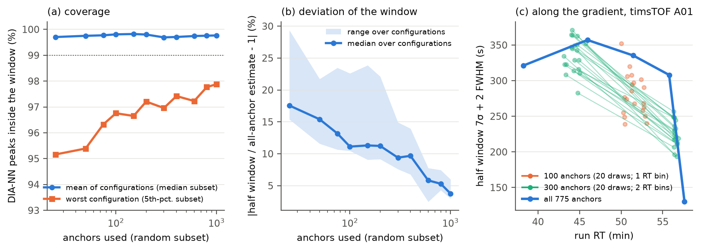
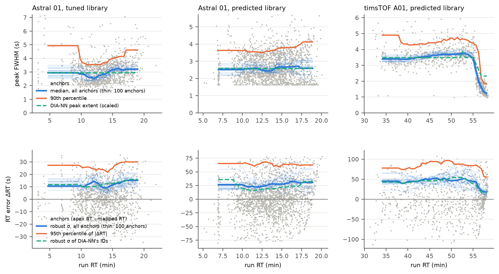
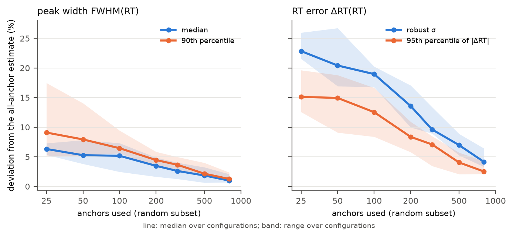

# RT-window estimation: how many anchors, what sets the width, and whether to re-extract (2026-10-20)

The window (`-rt_window 0`, the default) is measured from the calibration anchors, per RT bin of about 150 anchors (at
most 8, linear in between): **7 × the robust scatter (1.4826 MAD) of the anchors' apex RT about the RT map + 2 × their
median peak width (FWHM)**. Data: the ten benchmark configurations of `results/rtwin/all/` (Astral runs 01–03 with
tuned libraries, Astral 01 with the predicted entrapment and human libraries, timsTOF A01/B01 with the predicted
library) and their DIA-NN 1.7.12 IDs at 1% FDR. Scripts and tables: `results/rtwin/converge/` (not in git).

## How many anchors does the window need?

Random subsets of each configuration's anchors (100 draws per size), the window computed as the tool does, scored by
the share of DIA-NN's whole peaks [RT.Start, RT.Stop] inside it (`converge.py`, figure a, b):

| anchors | median deviation from the all-anchor window | coverage, mean of configurations | coverage, worst configuration's 5th-percentile draw |
|---|---|---|---|
| 25 | 18% | 99.70% | 95.2% |
| 100 | 11% | 99.81% | 96.8% |
| 300 | 9% | 99.69% | 97.0% |
| 600 | 6% | 99.74% | 97.2% |
| 1000 | 4% | 99.77% | 97.9% |
| all (710–2,652) | – | 99.4–100% | – |

The typical window is robust (7σ is generous), but small samples miss the tails in some draws, and below 300 anchors
the rule has one RT bin, so the window's dependence on RT is lost (figure c: the narrowing at the end of the timsTOF
gradient, ±357 → ±130 s, needs all 775 anchors). The configurations have 700–2,650 anchors: about what the coverage
needs, not a surplus to subsample.

## The panel: time against anchors

The anchors come from a panel of 5% of the library (two search stages). Smaller panels, one run each (`panel.sh`):

| configuration | panel | anchors | calibration | RT window |
|---|---|---|---|---|
| Astral 01, predicted entrapment (7.0 M) | 350 k / 175 k / 88 k / 44 k / 22 k | 2,652 / 1,279 / 682 / 328 / failed | 1.19 / 0.70 / 0.49 / 0.29 s | ±214–319 / ±195–368 / ±209–286 / ±167–223 s |
| Astral 01, predicted human (3.5 M) | 174 k / 87 k / 44 k / 22 k / 11 k | 1,839 / 952 / 481 / 258 / failed | 0.59 / 0.36 / 0.27 / 0.17 s | ±159–225 / ±151–255 / ±163–221 / ±212 (1 bin) s |
| timsTOF A01 (4.15 M) | 208 k / 104 k / 52 k / 26 k | 775 / 321 / 118 / failed | 4.51 / 4.24 / 2.29 s | ±130–357 / ±228–309 / ±150 (1 bin) s |
| timsTOF B01 | 208 k / 104 k / 52 k / 26 k | 710 / 362 / 170 / failed | 4.20 / 3.78 / 2.03 s | ±122–306 / ±258–324 / ±217 (1 bin) s |

The calibration is 7–8% of a run (Astral 7 M: 1 s of 12.5 s; timsTOF: 4.5 s of 52–64 s), and shrinking the panel buys
little of it: on Astral 0.5–0.9 s at the cost of half to three quarters of the anchors, on timsTOF nothing at half the
panel (4.5 → 4.2 s; the first stage scans the whole run per isolation window, with only 24 windows to parallelise over)
and 2 s at a quarter, where the window has collapsed to one RT bin. At 1/8 (timsTOF) and 1/16 (Astral) the calibration
fails (fewer than 50 first-stage anchors). The default panel stays.

A non-change measured on the way: the second stage also re-extracts every anchor at 2–8 σ for a co-elution curve that
only chooses the MS2 multiple when no instrument file sets it. Skipping it saved nothing measurable (0.96 vs 1.03 s,
4.81 vs 4.77 s; outputs identical), so it stays.

## What sets the width

| configuration | 7 σ (s) | 2 FWHM (s) | FWHM share of the window |
|---|---|---|---|
| Astral, tuned entrapment library | 57–111 | 3.3–6.6 | 7% |
| Astral, tuned human library | 35–69 | 3.3–6.6 | 12–13% |
| Astral, predicted libraries | 157–315 | 3.3 | 1–2% |
| timsTOF, predicted library | 119–349 | 1.9–7.7 | 2% |

The window is the RT map's error, not peak broadening: peaks are 1–5 s wide (anchors' FWHM, 5th–95th percentile),
the scatter of their apexes about the map is 5–50 s. Measuring the FWHM on all extracted traces would refine a term
worth 1–13% of the window, and could only be done after the extraction the window is for. What narrows the window is
a better RT prediction: a tuned library has a third of a predicted one's window (§2 of the release report).

## Extract narrow, re-extract where needed?

For narrower rules (k σ + 2 FWHM), the share of DIA-NN's peaks fully inside, cut at the window's edge (visible, so a
second pass could widen those traces) or fully outside (invisible: lost) (`adaptive.py`):

| rule | lost, worst / mean configuration | at the edge (recoverable), worst | window width vs 7 σ |
|---|---|---|---|
| 3 σ | 6.2% / 1.7% | 4.3% | 47% |
| 4 σ | 4.7% / 0.9% | 2.0% | 60% |
| 5 σ | 3.2% / 0.5% | 0.9% | 73% |
| 7 σ (default) | 0.27% / 0.06% | 0.3% | 100% |

The misses are mostly complete: the map's error has heavy tails, a precursor it places far off leaves nothing in a
narrow window to trigger a second pass. Re-extracting edge cases would recover at most the middle column. Reusing the
calibration's own traces is no shortcut either: they cover 5% of the precursors, with the search tolerance and the
first map's window, not the final ones.

## Where time could still come from

- The first calibration stage on timsTOF (about half of its 4.5 s) is parallel over isolation windows only (24 on
  diaPASEF): splitting each window's run into RT segments would use the 32 threads; worth 1–2 s of a 52–64 s run.
- The timsTOF ingest (mzPeak read and mobility collapse, 19–25 s) is the largest serial-ish block of those runs.
- A narrower window needs better library RTs (tuning), not a different estimator.

## Two independent estimators along RT: peak width and RT error

The window combines two quantities that can be estimated separately, each as a function of run RT. From the anchors
alone, as a running statistic over the 20% of anchors nearest in RT (a window that follows the anchor density;
`results/rtwin/converge/estimators.py`):

- **FWHM(RT)**: the median (and 90th percentile) of the anchors' peak FWHM. Measured until now in whole cycles (the
  cycles of the summed fragment trace above half its apex), which on Astral is 1.65 s steps: the running median sat on
  one or two values and could not show broadening. The anchors file (`-out_calibration`) now also carries
  `fwhm_interp_s`, the half-apex crossings interpolated between cycles (in run time); the window itself still uses the
  whole-cycle value, so no output changes.
- **ΔRT(RT)**: the robust scatter (1.4826 MAD) and the 95th percentile of |ΔRT| of the anchors' apex RT about the RT
  map.

Each is checked against an independent reference from DIA-NN's IDs at 1% FDR (45–73 k per configuration, against
700–2,650 anchors): DIA-NN's peak extent RT.Stop − RT.Start (its boundaries, not a FWHM: compared in shape after one
scale factor, 2.5–3.9 × the FWHM) and the scatter of DIA-NN's apex RT about our mapped RT.

| configuration | FWHM(RT), anchors | DIA-NN extent, scaled | shape deviation | ΔRT σ, anchors vs DIA-NN | 95th percentile, anchors vs DIA-NN |
|---|---|---|---|---|---|
| Astral, tuned entrapment libraries | 2.5–3.4 s | 2.8–3.3 s | 3–5% | −6 to −18% | −17 to −28% |
| Astral, tuned human libraries | 2.6–3.4 s | 2.9 s | 4–7% | −8 to −17% | −18 to −28% |
| Astral, predicted libraries | 2.2–2.7 s | 2.5–2.6 s | 1–3% | +30 to +36% | −10 to +25% |
| timsTOF A01/B01 | 1.2–3.7 s | 2.3–3.9 s | 3–4% | −7 to +5% | −13 to −31% |

- **Peak broadening is real but small.** The interpolated FWHM follows DIA-NN's peak extents within 1–7% (median
  over RT). On timsTOF it changes along the gradient (3.4–3.7 s, dropping to 1.2 s in the last minutes where the
  gradient steepens); on Astral it varies by about a third, where DIA-NN's extent is nearly flat. Twice the FWHM is
  2–13% of the window.
- **The RT error is what matters, and the anchors are a biased sample of it.** With tuned libraries the anchors'
  scatter is 6–18% below that of DIA-NN's IDs and their 95th percentile 17–31% below; with predicted libraries the
  scatter is 30–36% above. Anchors are strong, clean peaks; the IDs include weak ones. The 7σ multiple was chosen on
  the IDs' peaks and absorbs this.

**Convergence** (random subsets of each configuration's anchors, 50 draws per size; deviation = median over RT of
|estimate(n)/estimate(all) − 1|; median and range over the ten configurations):

| anchors | FWHM median | FWHM 90th pct. | ΔRT σ | ΔRT 95th pct. |
|---|---|---|---|---|
| 25 | 6.3% | 9.1% | 23% | 15% |
| 100 | 5.2% | 6.5% | 19% | 13% |
| 200 | 3.5% | 4.5% | 14% | 8% |
| 300 | 2.6% | 3.7% | 10% | 7% |
| 500 | 1.8% | 2.1% | 7% | 4% |
| 800 | 1.0% | 1.3% | 4% | 2.5% |

The peak width converges about four times faster than the RT error: 100–200 anchors give FWHM(RT) to 5%, while
ΔRT(RT) needs 500–800 for the same. So the estimators could be fed differently, the width from any well-shaped
peaks (many more than anchors), the RT error from a sample representative of the IDs rather than of the cleanest
peaks, but the window's width is the RT error's, and it is the RT error's sample that cannot shrink.
