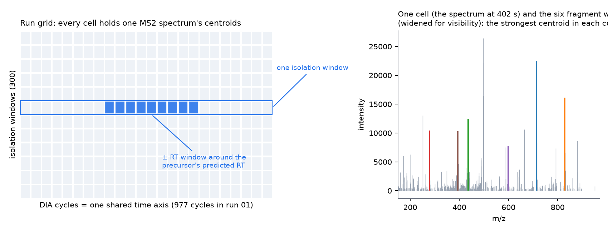
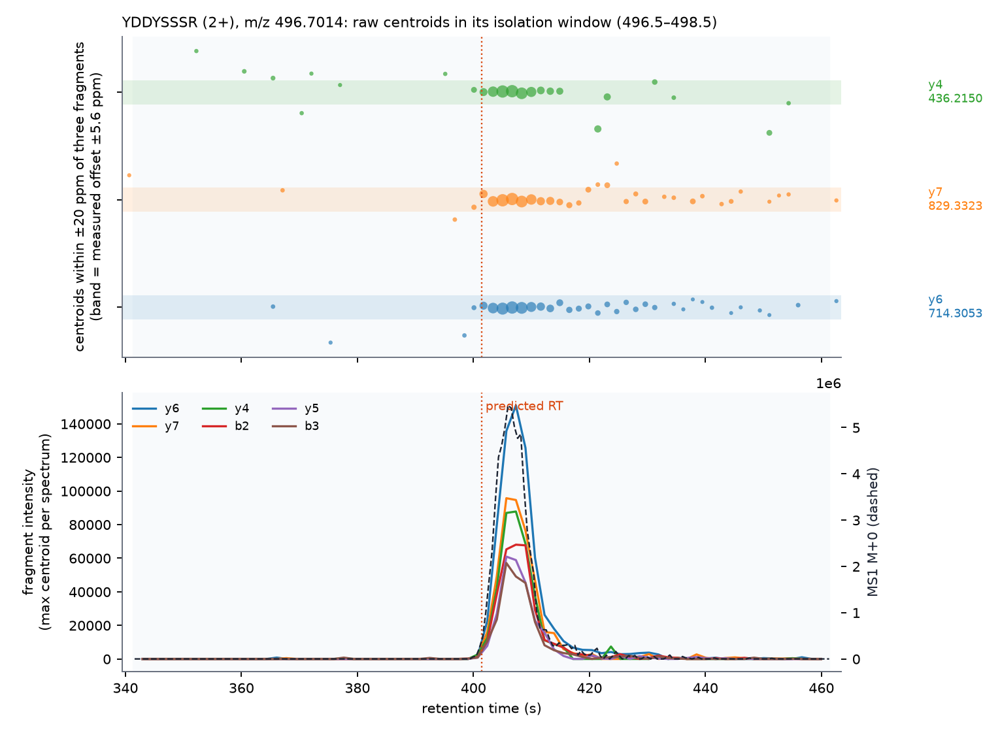
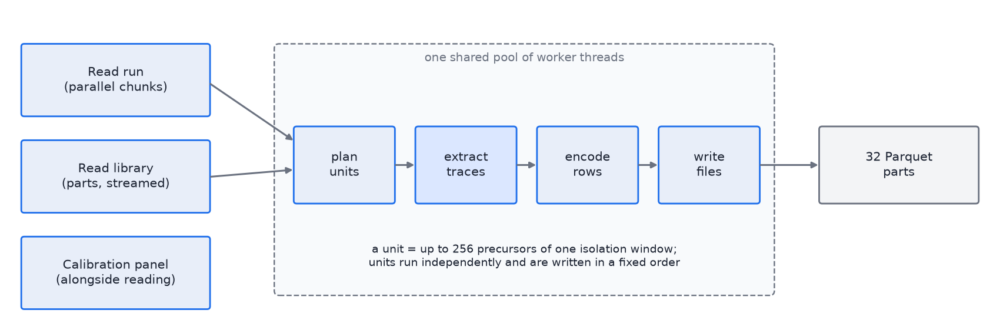

# How DIATraceExtractor extracts traces

DIATraceExtractor reads one DIA run and one spectral library and writes, for every library precursor, the
intensity traces of its fragments and of its MS1 isotopes around the retention time the library predicts. It
does nothing else: no scoring, no identification, no FDR. The traces are meant to be compared point by point with
those of other engines, and to feed whatever scoring comes next.


What the extraction needs to know about the run — how far the masses are off, how wide the mass windows have to
be, and with `-rt_mode auto` how far the retention times are off — it measures from the run itself before
extracting.

## 1. The run as a grid

A DIA run visits the same set of isolation windows over and over; one pass over all windows is a cycle. The
extractor lays the run out as a grid: one row per isolation window, one column per cycle, and in every cell the
centroids of the MS2 spectrum acquired for that window in that cycle (cells stay empty when the instrument
skipped a window). A cycle ends when a window repeats. The time of a cycle is the mean acquisition time of its
spectra, so every MS2 trace in the run shares one time axis; the exact acquisition time of every spectrum is kept
alongside.



MS1 spectra are acquired on their own schedule (three per cycle on the Astral method used here) and are kept on
their own axis of MS1 scans: an MS1 trace holds the raw value at every MS1 scan in the time window, nothing is
interpolated. Centroids are stored as fixed-point m/z (10⁻⁵ Th steps, i.e. 0.01 ppm at 1,000 Th) and a float
intensity: 8 bytes per centroid, 1.1 GB for a 141 M-centroid run.

Input formats: centroided mzML, mzPeak (point or chunked layout; the MS1 spectra must be centroided in the
file), Thermo `.raw`.

## 2. Where to look

For a precursor the library gives its m/z, its charge, a retention time and the m/z and relative intensity of its
fragments.

**Which isolation window.** A window is identified by its isolation target m/z and edges (the mzML's isolation
window target, not the selected-ion m/z). The precursor is extracted from the window whose centre is nearest to
its m/z among the windows that contain it (`-window_assignment nearest`; `all` extracts from every containing
window). Overlapping or staggered window schemes have not been tested.

**Which cycles.** The library retention time is mapped to run seconds (`-rt_mode`): as is, in minutes (DIALibGen's
tuned libraries carry run minutes), a linear map, a transformation file, external anchors, or `auto`, which fits
the map from the run (§4). The trace covers the cycles within ±60 s of the mapped time (`-rt_window`, a half
width; ≤ 0 extracts the whole run). The window is a fixed default, not measured; what the calibration says about
the remaining RT error is reported (§4) and can be used to change it.

**Which centroids.** For every fragment, the centroids of a cell within a mass window around the fragment's m/z.
The window is the fragment m/z, shifted by the mass offset measured from the run, ± the tolerance measured from the
run (§4; `-mz_tol`/`-mz_tol_ms1` set a fixed ± ppm instead). The trace value is the **most intense centroid in the
window** (`-aggregation max`); `sum` adds them up as OpenSWATH does. Max was chosen because a wide-enough window
regularly holds a second, unrelated centroid, and adding it distorts the peak shape more than ignoring it.



*Top: the raw centroids within ±20 ppm of three fragments of one precursor, over the ±60 s window around its
predicted RT (dotted line). The shaded band is the window the extractor uses: the measured offset (−3.2 ppm on
this run) ± the measured tolerance. Bottom: the six fragment traces and the MS1 M+0 trace that result.*

**MS1 isotopes.** For each precursor the monoisotopic peak and the next `-ms1_isotopes` (default 2) isotopes at
m/z + k·1.00336/z are extracted from the MS1 scans in the same time window, with the MS1 offset and tolerance
(`-ms1_isotope_spacing unit` reproduces OpenSWATH's charge-independent spacing).

## 3. What comes out

One Parquet dataset (32 part files) with one row per trace: the precursor (id, sequence, charge, m/z, window),
the fragment (type, ordinal, charge, loss, library intensity) or isotope, the library target m/z (uncorrected;
the applied offsets are in the footer), the first cycle (or MS1 scan) of the trace and the intensities as a float32 array (`-encoding log8`: one byte per
point with a per-trace scale). A companion `*.axes.parquet` holds the cycle times, the MS1 scan times and the
acquisition time of every window spectrum. The footer records the input, the RT map, the offsets and tolerances
used. Reading it:

```python
import numpy as np, pyarrow.dataset as ds, pyarrow.parquet as pq
t = ds.dataset("traces.parquet").to_table().to_pandas()
axes = pq.read_table("traces.axes.parquet").to_pandas()
cycle_rt = axes[axes.lane == -1].sort_values("cycle").rt.to_numpy()      # lane -2: MS1 scan times
row = t[t.ms_level == 2].iloc[0]
y = np.frombuffer(row.intensity, "<f4"); rt = cycle_rt[row.cycle_begin:row.cycle_begin + len(y)]
```

## 4. Calibration from the run itself

The predicted library does not know this run's retention time drift or this instrument's mass calibration, and
the extractor must not take either as given. `-mass_calibration auto` (the default) and `-rt_mode auto` measure
them from a panel of library precursors.

**Panel.** 5% of the library rows (`calibration:panel_fraction`; 350,000 for the 7 M-row entrapment library),
taken from evenly spaced rows and then from the target precursors with at least 4 fragments, spread evenly over
library retention time. The panel is drawn
from the whole library even when `-ids` restricts the extraction, so that calibrating on externally confirmed
precursors is not mistaken for self-calibration.

**Finding anchors.** For each panel precursor the traces of its 6 most intense fragments are built over the whole
run with a wide mass window (±50 ppm in the first pass). The fragments' sum is scanned for its five largest local
maxima that lie at least 8 cycles apart; an apex is accepted as an *anchor* when, over ±4 cycles around it,
- at least 5 fragments have signal at the apex,
- the fragment traces co-elute: mean pairwise Pearson correlation ≥ 0.90,
- the apex intensities resemble the library: cosine of √intensities ≥ 0.85.

These strict criteria (stage 1) produce a few hundred anchors per run (fewer than 50 is an error). A robust first
RT curve is drawn through them: the anchors are cut into up to 20 equal-count bins along library RT (fewer with
few anchors) and in each the most common run RT is taken, so that scattered false anchors cannot pull the curve;
anchors far from it (more than 60 s) are dropped, and if fewer than 20 remain the run cannot be calibrated. A
LOWESS curve (span 0.15) is then fitted with three rounds of outlier rejection at max(3σ, 3 s).

**Stage 2** repeats the search only within ±max(4σ, 30 s) of that curve, with relaxed criteria (4 fragments,
correlation ≥ 0.80, cosine ≥ 0.75), and the final RT map is fitted to the result. On the Astral runs this gives
1,800–1,900 anchors with 95% of them within ±43 s of the map, which is the reason for the ±60 s default window.


**Mass offsets and tolerances.** At each anchor's apex the most intense centroid of every fragment is taken and
its distance to the library m/z recorded in ppm, likewise the monoisotopic MS1 centroid at the nearest MS1 scan.
From these apex errors (of the anchors that pass the strict criteria, including the fragment count, when there
are at least 200 of them; at least 50 centroids are needed for a measurement):
- the **offset** is the median (unweighted: strong centroids drift upward on this instrument, which biases a
  weighted median);
- the **width** is 1.4826 × the median absolute deviation, a measure that the random centroids of a few false
  anchors do not move;
- the **tolerance** is 6 × that width (`calibration:accuracy_sigma`), never below 0.1 ppm.

The mass search then narrows to ±3 × the tolerance around the offset (never wider than the first pass) and the
anchors are searched again, so that the first wide pass does not bias the offset; the passes stop when the window
and the offset change by less than a quarter of the window (at most `calibration:search_rounds`, 3). On the three Astral runs and both libraries the width is 0.84–1.08
ppm at MS2 and 0.37–0.43 ppm at MS1, giving tolerances of ±5.0–6.5 ppm and ±2.2–2.6 ppm; the offsets are
−3.2 / −2.4 / −2.0 ppm (MS2) and +1.3 / +1.2 / +1.4 ppm (MS1) on runs 01 / 02 / 03. The multiple 6 is the one
constant of this rule; it was chosen on the measured trade-off between captured signal and interference (the
±6 ppm optimum in `analysis/trace_quality.md`), and 5 reproduces DIA-NN's rule. A 99%-coverage point of the apex
errors, parametric or not, came out too narrow (±3–4 ppm) because apex centroids of confident anchors are the
best-measured points in the run; the flanks and the weak fragments the traces must also capture have larger
errors.

The whole calibration takes about one second (the anchor search uses at most 32 threads). The thresholds above
are `-calibration:*` options, except the 6 fragments per panel precursor and the sample-size floors (50 anchors,
20 consistent anchors, 200 strict anchors, 50 centroids); `docs/BACKLOG.md` lists the ones that should still
become data-driven (the co-elution window in cycles, the acceptance thresholds, the RT model's time constants).

## 5. How the work is divided

Four kinds of work, one pool of threads:



- **Reading the run** is parallel: an uncompressed mzML with plain or zlib arrays is cut into chunks at spectrum
  boundaries and each thread parses its chunk straight into one shared, memory-mapped pool of centroids (other
  mzML files go through OpenMS's parser on one thread); the cells of the grid are index ranges into the pool. mzPeak files are read in partitions of whole row groups, one reader per thread, into the same pool. The run
  is read in 0.3 s (mzML) or 0.9 s (mzPeak) at 64 threads.
- **The library is streamed.** A DIALibGen compact Parquet library is read in parts of 65,536 rows while
  extraction is already running, and the calibration panel is read from every n-th row on its own thread while
  the run is being read; TSV, TraML, PQP and other Parquet layouts are loaded whole.
- **Extraction** works in units: up to 256 precursors of one isolation window, sorted by retention time. A unit
  touches one row of the grid, and its precursors' time windows rise monotonically, so each cell's centroids are
  walked in one forward pass, in m/z order, against the fragment windows of the precursors active in that cell
  (a merge join; a small per-cell index skips m/z gaps). The same lookup serves the MS1 scans.
- **Encoding and writing** are separate tasks: a finished unit is encoded to Arrow rows and appended to one of 32
  Parquet parts. The scheduler hands out the four task kinds by pressure — a thread writes when output is
  waiting, extracts when traces are needed, reads when the library runs low — and commits units in a fixed
  order, so the output is byte-identical for any thread count (`tests/`: 1 vs 8 threads).
- **Memory** is bounded by design: the pool of centroids, the recycled trace buffers (512 MiB) and a bounded
  number of units in flight. The full 7 M-precursor library (63 M traces, 7.7 G points) runs in 8.6 s at 64
  threads with a peak of 4.7 GiB; the 82 k-precursor shared library in 1.8 s.

## 6. Main options

| option | default | meaning |
|---|---|---|
| `-rt_mode` | `linear` (as is) | `minutes` for DIALibGen tuned libraries; `auto` fits the map from the run |
| `-rt_window` | 60 s | half width of the extraction window around the mapped RT (≤ 0: whole run) |
| `-mass_calibration` | `auto` | measure the MS2/MS1 offsets (and the tolerances when they are 0) from the run |
| `-mz_tol`, `-mz_tol_ms1` | 0 = measured | ± ppm half widths; a value fixes them |
| `-aggregation` | `max` | most intense centroid in the window (`sum`: their sum) |
| `-top_fragments` | 6 | fragments per precursor by library intensity (0: all) |
| `-ms1_isotopes` | 2 | isotopes after the monoisotope (−1: no MS1) |
| `-ms1_axis` | `scans` | MS1 at its own scans (`cycles`: interpolated onto the cycle axis) |
| `-ids` | — | restrict the extraction to listed precursors (the calibration panel is not restricted) |
| `-calibration:*` | see `--help` | panel share, search widths, anchor criteria, RT model, tolerance multiple |
| `-threads`, `-out_shards` | 1, 32 | worker threads; Parquet parts |
| `-out_calibration`, `-out_stats` | — | anchors as TSV (usable as `-rt_anchors`); run statistics as JSON |
